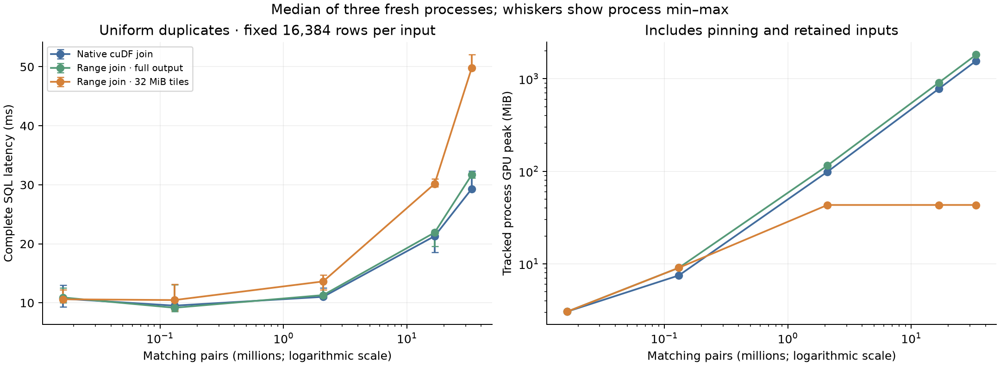
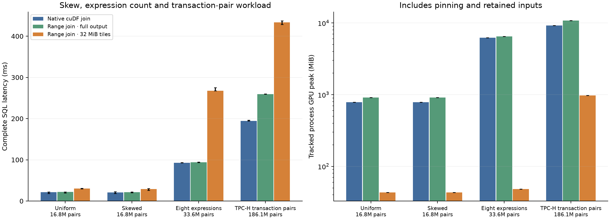
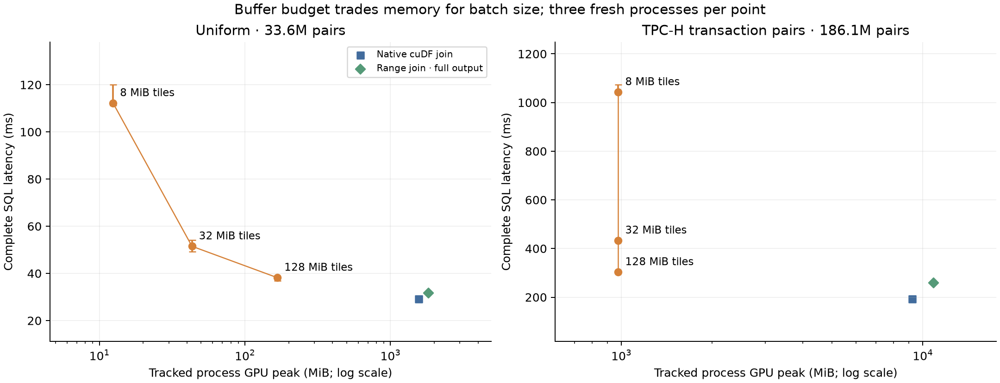
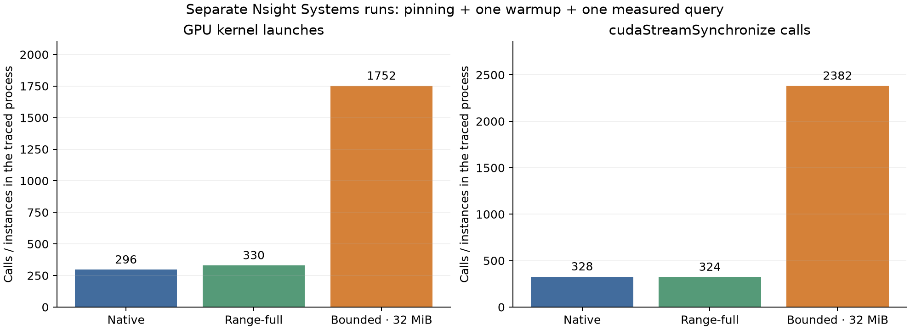

# Bounded join output in Sirius: capacity gains with a throughput cost

The experiment supports the memory-capacity hypothesis, but **does not establish a general speedup**. Complete SQL execution over 33.6 million matching pairs used a median tracked GPU peak of **43.3 MiB instead of 1,561.4 MiB**, while latency increased from **29.3 to 49.8 ms**. A transaction-pair query on genuine TPC-H SF1 data produced 186.1 million matches: **976.5 MiB instead of 9,221.7 MiB**, at **433.5 instead of 194.3 ms**. With the GPU usage setting reduced to 8%, bounded execution completed all three pressure cases while both full-output implementations failed after their OOM retry limits.

An additional capacity check enumerated **4,294,967,296 matching pairs** from two 65,536-row inputs, evaluated ordinary batch expressions, and returned the correct sums/count in **5.14 seconds with a 53.3 MiB tracked peak**. This is one exploratory capacity measurement, not a repeated performance claim.

Work is on `research/bounded-join-output`, branched from research checkpoint `81a8d940`. The earlier custom fusion and join-map SUM gates were disabled in every run. The new implementation is experimental and off by default. No production optimization PR is claimed ready.

## Question and implementation

The question is whether join output can be produced in bounded pieces and consumed by ordinary vector operators without first allocating complete match-index arrays. This differs from slicing an already-materialized output or merely shrinking probe input batches: one probe row can itself have more matches than fit in an output tile.

```text
Native:       hash join → complete match maps → complete gathered batch
                         → ordinary expression evaluation → local aggregate → merge

Range-full:   sorted build index → per-probe matching ranges → complete match maps
                         → same ordinary expression evaluation → local aggregate → merge

Bounded:      same sorted build index and matching ranges
                         → one tile of match maps → gathered tile
                         → ordinary expression evaluation → local aggregate
                         → release tile, resume the next match position → merge partials
```

The [range producer](../../src/cuda/bounded_join_output.cu) sorts build keys while retaining their original row IDs. cuDF lower/upper-bound searches find each probe row's matching interval. A 64-bit prefix array gives every output pair a position. The producer expands only the next tile of positions, including when that tile boundary cuts through a single probe row's matching interval. Every pair is visited. Range lengths assign output positions; they do not replace SQL expression evaluation with key-count multiplication. **There is no engine input pre-aggregation.**

The [join integration](../../src/op/sirius_physical_hash_join.cpp) preserves the physical plan's build/probe identities, partitioning and BUILD_PROBE scheduling, caching the sorted index per build partition. It uses a different matching algorithm from native cuDF hash joining; that is why the range-full control exists. The [pipeline integration](../../src/pipeline/gpu_pipeline_task.cpp) drains each tile through existing operator implementations and retains their compact local partials for the existing merge. It introduces no scalar interpreter and does not change DuckDB's optimizer or exchange the selected build/probe inputs in timed runs.

Initial scope is inner joins with one INT32/INT64 equality key and fixed-width gathered payloads, followed within the same task by projections/filters and a terminal ungrouped non-distinct SUM/COUNT/MIN/MAX/AVG. Unsupported shapes retain native execution. The producer callback is independent of the aggregate expression, but this first engine integration restricts consumers to keep publication private and small. It does not yet implement general pipeline continuations or asynchronous downstream backpressure.

`SIRIUS_EXP_JOIN_OUTPUT=bounded` selects the experiment; `range_full` selects its control. `SIRIUS_EXP_JOIN_TILE_BYTES` is an explicit storage-budget parameter, with 32 MiB used for the main comparison. Tile row counts conservatively budget two INT32 index arrays plus gathered fixed-width values and validity allowance. This is a target for primary output buffers, **not a cap on all query memory**: input/index preparation, allocator overhead, expression scratch and aggregate partials are additional costs.

## Experimental design

The actual Sirius library and DuckDB extension were rebuilt. All final SQL validation, measurements and profiles used library SHA-256 `a90bbd2b857e1c08184341f409ef50c2c5900dd5cf2cc2d5bd1ff871c785ae30`. Hardware is one NVIDIA RTX 5060 Ti, 16 GB. Commands ran through the repository CUDA12 Pixi environment and GPU processes ran serially.

All timed cases execute normal SQL through Sirius with GPU interception enabled, CPU fallback disabled, `ast_interpret`, compressed materialization disabled, KvikIO compatibility I/O, one pipeline worker, no dynamic filters or scan cache. Required columns are pinned on the GPU before timing. Timings cover `execute(...).fetchall()`, including planning and the execution pipeline, excluding extension startup, pinning and reference computation. These settings isolate a single query's output-memory behavior; they do not establish production concurrency throughput or cold-storage performance.

The [predeclared protocol](results/protocol.json) has 99 fresh processes:

- Main comparison: eight workloads, three strategies, three fresh processes per cell; one warmup and three measured repetitions each. Strategies rotate order across trials.
- Budget sweep: two workloads, 8/32/128 MiB tiles, three processes per point, one warmup and three measured repetitions.
- Pressure checks: three workloads and three strategies, one measured execution each with no warmup and `usage_limit_fraction: 0.08`, approximately 1.3 GB usable GPU allocation capacity. Normal comparisons use 0.75. Host spill is configured; disk spill is not configured.

This gives **270 primary measured queries and 90 warmups**, all successful and reference-checked, plus **three successful pressure measurements and six observed OOM failures**. Failed queries have no successful-latency samples and are not converted into speedup ratios. All six exhausted the engine's 100-retry limit; none was merely classified from a timeout. The retained `oom_log_mentions` field counts log text occurrences, not unique attempts.

The [datasets](results/datasets.json) vary uniform key multiplicity with 16,384 rows per side. Uniform-1024 and a 25%-hot-key distribution have nearly equal output counts, 16,777,216 and 16,789,504, to examine skew separately from total output size. The narrow query computes two cross-input product SUMs and COUNT; the wide variant computes eight SUMs and COUNT, forcing more payload columns to survive pruning. Width and expression count change together in that variant, so it does not isolate payload width alone.

The TPC-H-derived transaction-pair query compares quantities for same-product transactions, using a CASE to count only ordered transaction pairs in its distance sum. It deliberately exercises ordinary decimal arithmetic and conditional evaluation:

```sql
SELECT count(*),
       sum(CASE WHEN a.l_orderkey < b.l_orderkey
                THEN abs(a.l_quantity-b.l_quantity) ELSE 0 END)
FROM lineitem a
JOIN lineitem b ON a.l_partkey=b.l_partkey;
```

It joins 6,001,215 lineitems to themselves and returns `(186086431, 1499890800.00)`. An independent CPU DuckDB execution established this reference. This is a constructed transaction-analysis query on real benchmark data, **not an official TPC-H query or evidence of production workload prevalence**. Synthetic expected sums/counts use an independent frequency/sum identity as a CPU oracle to avoid enumerating billions of CPU pairs; the GPU implementations do enumerate those pairs. Small semantic tests independently compare ordinary CPU SQL results.

Figures show medians of three process medians; each process median uses its three measured repetitions. Whiskers show the min/max process values, not confidence intervals. Memory is Sirius/cuCascade's **tracked allocation high-water mark for the process**, including pinning and retained inputs; it is not device-wide VRAM residency, reserved pool size or measured memory traffic. Three process trials and unlocked GPU clocks limit precision.

## Figure 1: output expansion at fixed input size



**Finding.** Native and range-full memory grow strongly with match count. At 33.6 million pairs they reach 1,561.4 and 1,818.0 MiB. The 32 MiB tiled path levels off near 43.3 MiB once more than one tile is needed. Its latency nevertheless rises to 49.8 ms, compared with native 29.3 ms and range-full 31.7 ms. Small-output latency ranges overlap; their few-percent differences do not establish a speed advantage.

**Explanation.** Full-output implementations keep match maps and gathered columns sized to the probe batch's entire output. The tiled implementation releases gathered values and expression intermediates after local aggregation, then reuses the available memory for subsequent tiles. It retains an input-sized range/prefix representation rather than all pairs. Bounded storage does not remove pair processing or intermediate writes: those writes occur tile by tile. More tiles require repeated calls into ordinary vector operators, allocations, reductions and synchronization. Range-full shares the sorted index, prefix construction and pair-expansion kernel with the tiled path, so their difference more directly exposes the cost of tiled consumption; native comparisons also include a join-algorithm change.

## Figure 2: skew, wider expression inputs and transaction pairs



| Workload | Native ms | Range-full ms | Bounded ms | Native peak MiB | Range-full peak MiB | Bounded peak MiB |
| --- | ---: | ---: | ---: | ---: | ---: | ---: |
| Uniform, 16.8M pairs | 21.30 | 21.91 | 30.16 | 781.4 | 910.0 | 43.3 |
| Skewed, 16.8M pairs | 20.56 | 21.47 | 29.15 | 782.0 | 910.6 | 43.3 |
| Eight expressions, 33.6M pairs | 92.94 | 94.26 | 267.81 | 6,243.7 | 6,501.0 | 48.1 |
| TPC-H transaction pairs, 186.1M pairs | 194.30 | 259.35 | 433.45 | 9,221.7 | 10,850.3 | 976.5 |

**Finding.** The selected uniform and skewed cases behave similarly at nearly equal output size; this experiment does not show a special skew-induced throughput collapse. More expression inputs increase full-output memory dramatically. Bounded execution reduces the wide case's tracked peak by roughly 130 times but is about 2.9 times slower than native. The transaction-pair query uses about 9.4 times less tracked peak memory with tiling, while taking about 2.2 times as long.

**Explanation.** Here output cardinality is more informative for temporary storage than input row count or the skew label alone. More gathered columns enlarge each full output and reduce the number of rows fitting a fixed tile budget. The wide case therefore incurs both more scalar/vector work and more tiles: it changes two factors at once. The TPC-H case has much larger inputs and preparation state, so its approximately 977 MiB peak is not expected to match the small synthetic case's 43 MiB peak. The native/range-full gap also shows that sorting/searching and per-pair rank decoding have their own cost; all of the native-to-bounded slowdown must not be attributed to tiling.

## Figure 3: the tile budget tradeoff



| Workload | Tile budget MiB | Median ms | Tracked peak MiB |
| --- | ---: | ---: | ---: |
| Uniform, 33.6M pairs | 8 | 112.22 | 12.4 |
| Uniform, 33.6M pairs | 32 | 51.50 | 43.3 |
| Uniform, 33.6M pairs | 128 | 38.19 | 167.1 |
| TPC-H transaction pairs | 8 | 1,042.94 | 976.5 |
| TPC-H transaction pairs | 32 | 433.23 | 976.5 |
| TPC-H transaction pairs | 128 | 303.18 | 976.5 |

**Finding.** A smaller buffer is not automatically better. Raising the synthetic tile budget from 8 to 128 MiB lowers latency from 112.2 to 38.2 ms while increasing tracked peak. In the transaction-pair case, the same change lowers latency from 1,042.9 to 303.2 ms without changing the recorded process high-water mark.

**Explanation.** Larger tiles amortize fixed per-batch work. The TPC-H process peak is dominated by another phase that is already larger than the tile-dependent working set across these three budgets. Pinning alone peaks around 370 MiB, below the approximately 977 MiB execution peak, so attributing the whole floor to pinning would be incorrect. Input/partition/index preparation and other execution allocations are plausible sources; the exact allocation responsible was not separately isolated. The flat process peak does not mean the three tile sizes allocate identical output buffers. This is why a fixed whole-query high-water mark can hide improvements within one phase.

The 32 MiB points in this sweep are fresh processes, separate from the main comparison; small differences in their medians are normal run variation. There is no workload-name threshold or fitted query-selection policy.

## Figure 4: dispatch and synchronization costs



These are separate Nsight Systems runs of the full SQL process, including pinning, one warmup and one measured query on the narrow 33.6M-pair case. Their instrumented wall times are excluded from the primary statistics.

| Strategy | Kernel launches | cudaStreamSynchronize calls | Summed kernel time ms |
| --- | ---: | ---: | ---: |
| Native | 296 | 328 | 40.99 |
| Range-full | 330 | 324 | 42.62 |
| Bounded, 32 MiB | 1,752 | 2,382 | 40.87 |

**Finding.** The tiled process issues about six times as many kernels and over seven times as many stream synchronizations as native, despite similar summed kernel durations in these traces.

**Explanation.** The tiled query processes 45 tiles per SQL execution. Each tile traverses the existing batch evaluator and aggregate; the runtime wrapper also synchronizes after ordinary operators. These boundaries multiply dispatch and completion work. The trace is consistent with a substantial dispatch/synchronization cost, rather than a claim that the tiled kernels perform vastly more total GPU execution. Kernel-duration sums are not wall-clock decompositions and include setup/pinning; they do not assign an exact fraction of the slowdown to any one cause. No DRAM-bandwidth, occupancy or hardware-counter claims are made.

## Memory pressure and large-output capacity

With the usage-limit setting reduced from 75% to 8%, all modes retained identical SQL, inputs, worker count and memory configuration. Each pressure case was a fresh process with no warmup:

| Matches | Native | Range-full | Bounded, 32 MiB |
| --- | --- | --- | --- |
| Uniform: 33,554,432 | OOM, retry limit | OOM, retry limit | Correct; 43.3 MiB peak |
| One hot key: 268,435,456 | OOM, retry limit | OOM, retry limit | Correct; 43.5 MiB peak |
| TPC-H pairs: 186,086,431 | OOM, retry limit | OOM, retry limit | Correct; 976.5 MiB peak |

**Finding.** The memory issue affects completion, not merely allocation statistics. Tiny synthetic inputs do not ensure a feasible join intermediate. The transaction-pair query also demonstrates the issue with genuine TPC-H input data.

**Explanation.** Native output maps/gathered columns must exist inside the join task before downstream consumers can release them. Raising a retry reservation cannot make these allocations fit the configured cap. Host spilling was available, but did not rescue these runs; this does not establish that every alternative spill/repartition strategy would fail. The result concerns this engine and configuration, not an assertion that all GPU join engines require full output materialization.

The [exploratory capacity protocol](results/capacity_protocol.json) then tested two 65,536-row inputs sharing one key under the same 8% setting. Bounded execution enumerated **2^32 matches** in **5,633 tiles**, at most **762,600 pairs per tile**, with correct results in **5,135 ms** and a **53.3 MiB** tracked peak. Native execution exhausted its OOM retry limit. Range-full explicitly rejected an output exceeding cuDF's single-table row limit. The output position and prefix array must therefore be 64-bit even though row IDs into each small input are INT32. This check was recorded separately after the primary study and has no repeated-run uncertainty estimate.

## Correctness and limits

- Thirteen SQL cases passed against independent CPU execution for both range-full and bounded modes under Compute Sanitizer: duplicate/null/negative values, decimal CASE arithmetic, null-safe equality, empty and all-null input, AVG/MIN/MAX, reversed SQL join order, and declined DISTINCT/residual/multi-key/grouped shapes. Both sanitizer runs reported **zero errors**. A forced-orientation correctness test made one probe row match 5,000 build rows across 32 tiles; another checked multi-tile decimal CASE evaluation. Optimizer build-side swapping was disabled only for those last two correctness stresses, never for timed experiments.
- All **22 SF1 TPC-H queries matched CPU results in native mode and all 22 matched with the gate enabled**, with fallback disabled. Only Q11 activated this restricted integration; the remaining queries test ordinary-path regression behavior. These one-shot checks are not evidence that all TPC-H queries benefit.
- Every successful primary, pressure and capacity query matched its reference. Pair-count markers account for every expected output pair, and recorded tile rows satisfy the configured primary-buffer budget calculation. The [verification manifest](results/verification.json) records the binary and source hashes. The full C++ unit suite was not run.
- The prototype drains synchronously within a task, retains its input locks/index and can occupy a worker for a long expansion. It does not yet yield/reschedule between tiles or propagate downstream credits across pipelines. No multi-GPU or concurrent-query qualification was performed.
- Local aggregate partials are retained until the task returns, so their count grows with the number of tiles. Input/index preparation grows with input size, and grouping/final materialized results could grow separately. **This is a bound on primary join-output buffers, not a proof of constant total query memory.**

## Research interpretation

The useful result is a measured **capacity–throughput tradeoff**. Bounded match production can preserve the existing batch evaluator's semantics, survive output expansion and cross a single-table representation limit. It does not make expression evaluation free, remove pair visits or guarantee higher throughput. With ample memory, native execution is the preferable measured baseline for the substantial cases here.

The next substantive research question is whether a continuation and scheduling contract can preserve this capacity advantage while reducing repeated dispatch/completion work and allowing the task to yield under contention. A memory-aware runtime would have to account for index preparation, expression scratch and retained partials as well as output tiles. The three tile-budget measurements show why simply choosing the smallest buffer is inadequate. Adding aggregate-specific rewrites or query-name thresholds is not supported by these findings.

This study establishes mechanism feasibility and a concrete bottleneck. It does **not** establish publication novelty or workload prevalence. Those require comparison with prior bounded/streaming join execution and representative external workloads before presenting this as a novel research contribution.

## Artifacts and reproduction

[Raw timings](results/timings.csv), [complete process outcomes/settings/results](results/outcomes.json), [summary statistics](results/summary.json), [capacity results](results/capacity_results.json), [TPC-H validation](results/tpch22_validation.json), sanitizer outputs, and Nsight CSV summaries are retained. Compact per-process logs are stored in `results/process_evidence.json.gz` and `results/capacity_evidence.json.gz` as JSON dictionaries from run name to evidence text. Generated datasets, raw process directories and binary profiler captures are ignored to avoid another large Git file count. Plotting uses the retained portable artifacts without requiring raw process directories.

Run GPU commands serially from the repository root:

```bash
pixi run -e cuda12 bash experiments/fused_join_aggregate/build_sirius_kvikio.sh
pixi run --manifest-path experiments/fused_join_aggregate/pixi.toml python experiments/bounded_join_output/generate.py --tpch
pixi run -e cuda12 python experiments/bounded_join_output/prepare_tpch.py
pixi run -e cuda12 compute-sanitizer --tool memcheck --error-exitcode 99 python experiments/bounded_join_output/check_semantics.py bounded
pixi run -e cuda12 compute-sanitizer --tool memcheck --error-exitcode 99 python experiments/bounded_join_output/check_semantics.py range_full
pixi run -e cuda12 python experiments/bounded_join_output/run_tpch.py native
pixi run -e cuda12 python experiments/bounded_join_output/run_tpch.py bounded
pixi run -e cuda12 python experiments/bounded_join_output/measure.py
pixi run -e cuda12 python experiments/bounded_join_output/capacity.py
pixi run -e cuda12 bash experiments/bounded_join_output/profile.sh
pixi run -e cuda12 python experiments/bounded_join_output/collect.py --verify-binary
pixi run --manifest-path experiments/fused_join_aggregate/pixi.toml python experiments/bounded_join_output/plot.py
```

The measurement scripts overwrite their corresponding output folders when rerun. The build script applies the retained cuCascade KvikIO patch to the pinned submodule. All commands here used `/root/.pixi/bin/pixi`; the separately locked plotting/generation environment uses DuckDB 1.4, while the built extension is loaded by the repository environment's DuckDB 2.0. The original pilot timings are excluded from every final figure and table.
