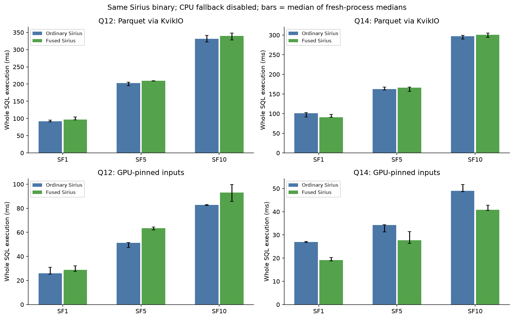
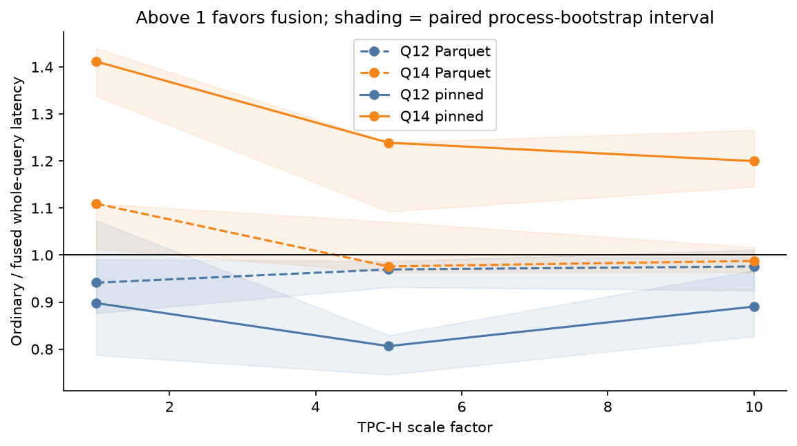
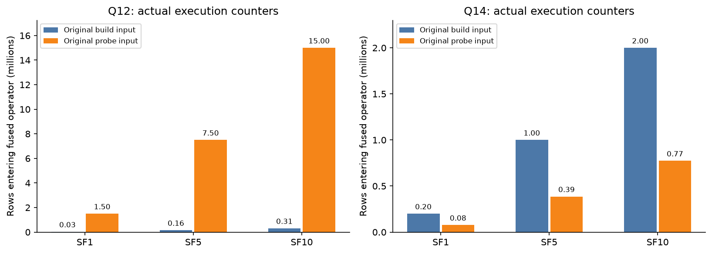
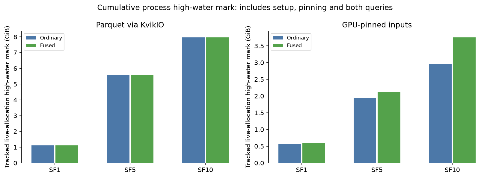
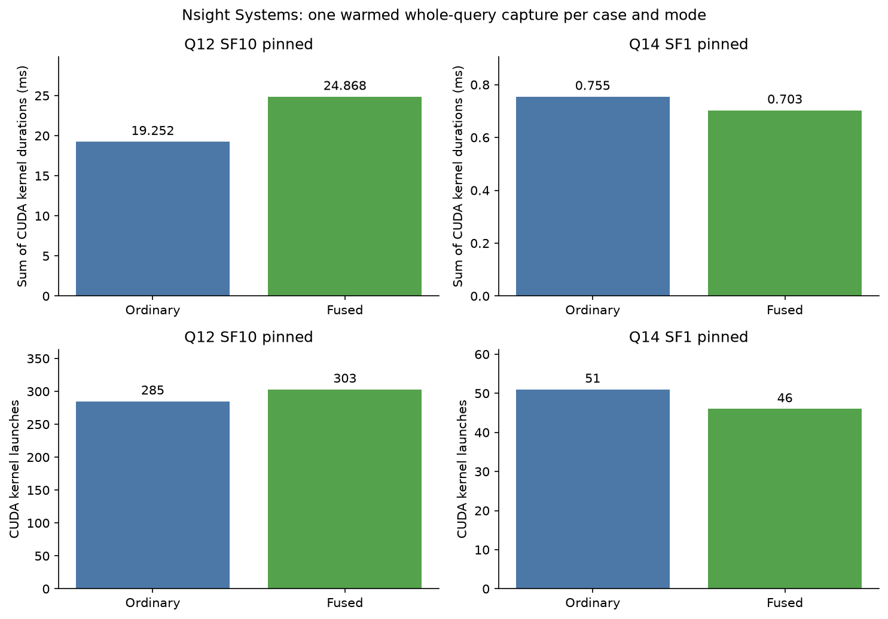
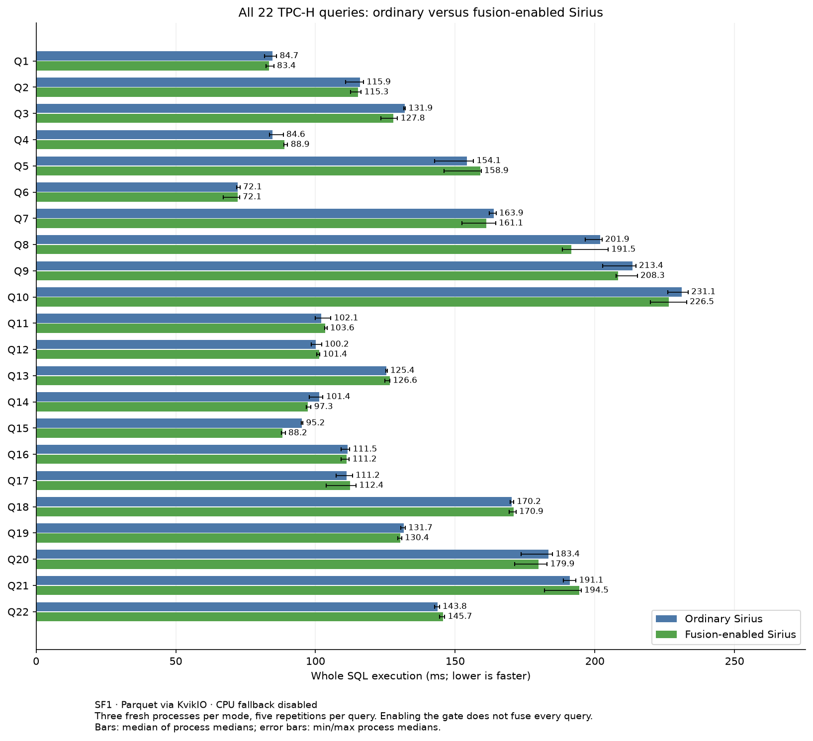
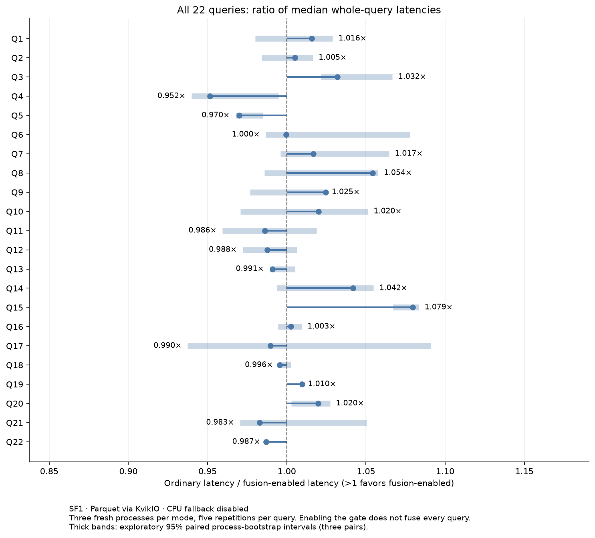

> Historical experiment preserving the optimizer's build side, with eager aggregate-expression evaluation. See [REPORT.md](REPORT.md) for the lazy revision.

Reference SQL/CPU fixtures are deduplicated in `results/reference_fixtures.json.gz`; see the [artifact guide](../README.md) for validation and restoration. Generated datasets and superseded pilots were removed during cleanup.

# Fused join and aggregation inside Sirius: preserving the optimizer's build side

The revised full-engine experiment preserves the build input selected by ordinary Sirius. It does not change DuckDB's optimizer or reorder the join to fit the fused kernel. KvikIO compatibility I/O supplies local Parquet data, and CPU fallback is disabled throughout.

The result remains workload-dependent. With GPU-pinned inputs, Q14 improves from 27.00 to 19.13 ms at SF1 (1.411×), from 34.28 to 27.67 ms at SF5 (1.239×), and from 48.98 to 40.83 ms at SF10 (1.200×). Q12 remains slower: 25.92 to 28.87 ms at SF1, 51.18 to 63.47 ms at SF5, and 82.83 to 93.03 ms at SF10. Including Parquet scans, Q12 SF10 changes from 331.66 to 339.92 ms and Q14 from 297.13 to 300.88 ms. A smaller hash build alone does not establish a fusion win.

The study contains **1,020 measured full-SQL executions**: 360 focused Q12/Q14 executions at SF1/SF5/SF10 and 660 executions covering all 22 SF1 queries. Every output matches an independent CPU result. Seven Python-generated plots below include findings and explanations. No pre-aggregation implementation, timing or comparison is included; matching pairs contribute individually after joining.

## What changed and what was verified

The first prototype forced aggregate values/groups onto the probe input and CASE conditions onto the build input. The revision carries each expression's input side explicitly. The kernel reads a value, predicate and group from the appropriate matched row, including multiple groups among one probe's matching build rows. It uses bounded per-group traversal and warp partial sums; it never replaces duplicate matches with per-key counts.

Ordinary Sirius's `HASH_JOIN` uses original child 1 as its build input and child 0 as its probe input. The rewrite now preserves those input identities. Its scheduling base stores build first internally, so its child numbering changes, but the table assigned to each role does not. The base supplies two-input FULL-barrier scheduling; its dense-count execution algorithm is overridden and unused.

At SF1 the verified roles are:

| Query | Ordinary and revised fused build | Ordinary and revised fused probe |
| --- | --- | --- |
| Q12 | Filtered lineitem: 30,912 rows | Orders: 1,500,000 rows |
| Q14 | Part: 200,000 rows | Filtered lineitem: 77,041 rows |

**Correction to the earlier report:** I had said ordinary Q14 also built on filtered lineitem. The fresh ordinary-engine debug log shows a 200,000-row part build using `BUILD_PROBE` and `distinct_hash_join`. That earlier Q14 explanation was incorrect. Preserving the original choice changes Q12's orientation; Q14 retains part. We preserve the actual plan rather than impose a new smallest-table rule.

The temporary ordinary debug runs established the role correction summarized above; their pilot files were removed during cleanup. [Retained measured fused evidence](results/sirius_eager/e2e_t0_p1_fused_sf1/operator_evidence.txt) records both input sizes and `original_build_child=1`. Per-run `plan_evidence.txt` retains the first physical pipeline plan for each SQL query; `operator_counts.json` records actual fused executions by query. The rewrite runs after physical plan creation and projection folding, before schema compression and pipeline splitting.

This removes the forced build-side change as a confound. The A/B still includes a custom chained hash versus Sirius's cuDF hash path, different expression placement, full-input concatenation and scheduling, and the removal of joined-row output. It is an integrated implementation comparison, not a controlled estimate of intermediate removal alone.

## Build, data and measurement boundaries

- Branch: `research/fused-join-aggregation`, based on main commit `83d6c0ee01f2a98b97ce04c74141e2881f49438e`.
- GPU: NVIDIA RTX 5060 Ti, 16,311 MiB; driver 595.99.02. CUDA 12.9.86, cuDF 26.10.02, RMM 26.10, native `sm_120` build.
- The actual Sirius library, DuckDB executable and extension were rebuilt. Python DuckDB 2.0 loads the extension linked to `build/release/install/lib/libsirius.so.0.0.0`; normal SQL passes through the real planner, scans, scheduler and GPU operators.
- Installed library SHA-256: `c41655b6a89397114f24393887658539d312a547c4b089df8d67afa50efa06f4`. All 42 primary processes use this binary. [Focused campaign](results/sirius_eager/campaign.json) and [all-query campaign](results/sirius_eager/all22_campaign.json) record hashes, counts and controls.
- Genuine TPC-H SF1, SF5 and SF10 databases generated using the experiment's separately locked DuckDB 1.4 environment, then exported to Snappy Parquet with 122,880-row groups. SF10 contains 59,986,052 lineitems. Data occupies about 11 GB, within the supplied 100 GB budget.
- SQL comes from `test/tpch_performance/queries.py`, including its scale-dependent parameters. Q14 uses August 1994. The older standalone appendix used September 1995, different kernels and narrower arithmetic; its absolute timings are not comparable.
- Ordinary and fusion-enabled execution differ only in `SIRIUS_EXP_JOIN_AGGREGATION=0/1`; the gate is off by default. `gpu_execution=true` and `enable_duckdb_fallback=false` are set and asserted. Dynamic filters are disabled in both arms. The [same configuration](sirius-kvikio.yaml) uses four scan/pipeline threads, one GPU, no scan cache/readahead and normal INFO logging.
- **Parquet:** local KvikIO read, decode and transfer are inside query execution. The OS page cache is not evicted, so this is a warmed filesystem workload, not cold storage throughput.
- **GPU-pinned:** Sirius loads the union of Q12/Q14 needed columns before timing. SF10 retains about 2.03 GiB of tracked allocations after pinning. KvikIO performs that load; repeated queries read resident inputs. Pinning time is recorded separately, and full tables are not pinned indiscriminately.
- Each comparison uses three fresh processes per mode, with two warmups and five measured repetitions per query in each process. Mode order is A/B, B/A, A/B across trials. GPU work runs serially. The focused matrix covers two queries, three scales and two input modes; the all-22 matrix covers SF1 Parquet only.
- Timed interval: `execute(sql).fetchall()`, including planning, scans, expressions, hash construction, scheduling, aggregation and result retrieval. Extension startup, view creation, data generation, pinning and independent CPU reference computation are excluded. Profiling/debug runs are separate from the timing campaigns.
- Points are medians of three process medians. Latency error bars show their minimum/maximum. Ratio bands resample three paired process medians with a fixed seed. These exploratory intervals have only three independent pairs and cannot establish cross-machine or release-level confidence. This is not an official TPC-H score.

KvikIO support is restored in both Sirius and cuCascade. The cuCascade gitlink is still pinned; its required local modifications, including restored implementation files, are retained as [cucascade-kvikio.patch](cucascade-kvikio.patch). The build script applies that patch. `backend: kvikio` and `KVIKIO_COMPAT_MODE=ON` select POSIX compatibility I/O, which works despite denied io_uring setup. These are not GPUDirect Storage measurements; remote URLs retain the native backend.

## Figure 1: full-query latency after preserving the build side



**Finding.** Q12 still regresses with resident inputs, particularly SF5 (51.18 versus 63.47 ms). Q14's resident-input advantage persists at all three scales in this campaign. Including Parquet scans greatly reduces that advantage; both queries are close to parity at SF10.

**Explanation.** Keeping Q12's small filtered build removes its oversized orders hash construction. It also means probing all orders and selecting the group from each matching lineitem. The current implementation still evaluates CASE predicates over orders before matching and allocates warp partials in proportion to the probe count. Ordinary Sirius can evaluate aggregate expressions over its much smaller joined result and stream probe batches. Full-input barriers and concatenation remain in the prototype. These implementation costs can outweigh removing the joined-row intermediate. Scans, decoding and transfers account for a substantial part of Parquet query time, diluting changes in the resident execution path; the two modes have different overlap, so subtracting their times is not a direct I/O measurement.

## Figure 2: speedups and exploratory uncertainty



**Finding.** The resident Q14 point estimates favor fusion, while resident Q12 favors ordinary Sirius. The near-parity Parquet results are much less compelling than a large standalone kernel ratio would suggest. Exact process-bootstrap intervals are listed below.

**Explanation.** Saving row materialization and pipeline stages can help Q14's small scalar result, but does not eliminate its hash or expression work. Q12 has two output groups and a large probe input; the revised kernel must handle varying build-side groups per match, and the implementation's work is not just the number of retained matches. Interval width reflects variation among these three process pairs, not certainty about the mechanism. Temperature, clocks, host scheduling and previous query state can affect short queries. Independent campaigns also need not have identical point estimates.

| Query | SF | Input | Ordinary ms | Fused ms | Speedup | Process-bootstrap interval |
| --- | ---: | --- | ---: | ---: | ---: | --- |
| Q12 | 1 | Parquet | 91.55 | 97.27 | 0.941× | [0.877, 0.991] |
| Q12 | 5 | Parquet | 202.99 | 209.40 | 0.969× | [0.932, 0.987] |
| Q12 | 10 | Parquet | 331.66 | 339.92 | 0.976× | [0.925, 1.011] |
| Q14 | 1 | Parquet | 101.13 | 91.17 | 1.109× | [1.013, 1.109] |
| Q14 | 5 | Parquet | 162.46 | 166.48 | 0.976× | [0.963, 1.070] |
| Q14 | 10 | Parquet | 297.13 | 300.88 | 0.988× | [0.964, 1.017] |
| Q12 | 1 | pinned | 25.92 | 28.87 | 0.898× | [0.787, 1.073] |
| Q12 | 5 | pinned | 51.18 | 63.47 | 0.806× | [0.746, 0.829] |
| Q12 | 10 | pinned | 82.83 | 93.03 | 0.890× | [0.827, 0.967] |
| Q14 | 1 | pinned | 27.00 | 19.13 | 1.411× | [1.338, 1.439] |
| Q14 | 5 | pinned | 34.28 | 27.67 | 1.239× | [1.093, 1.239] |
| Q14 | 10 | pinned | 48.98 | 40.83 | 1.200× | [1.146, 1.266] |

## Figure 3: actual input roles, with no optimizer reorientation



**Finding.** At SF10, Q12 builds 311,026 filtered lineitems and probes 15,000,000 orders. Q14 builds 2,000,000 parts and probes 773,932 filtered lineitems. The Q12 build is approximately 48 times smaller than the orders build in the first prototype. Q14's assigned build side does not change.

**Explanation.** The planner no longer searches for an orientation satisfying hardcoded expression-side assumptions. It retains original child 1 as build and remaps aggregate fields independently. A Q12 order can match lineitems in different shipping-mode groups, so selecting a group once per probing order would be wrong; the revised kernel selects it per matching pair. The tiny Q12 build bars are expected consequences of its selective date/shipping predicates, not data truncation. CPU comparisons validate the complete outputs at all three scales.

## Figure 4: process allocation peaks do not follow hash size alone



**Finding.** At SF10 Parquet, the tracked process high-water mark is approximately 7.97 GiB in both modes. With GPU-pinned inputs it is 2.96 GiB ordinary versus 3.75 GiB fused. Preserving Q12's smaller build does not make the fused process use less memory in this measurement.

**Explanation.** The fused node still waits for both complete inputs and concatenates them while their source batches remain alive. Key casts, evaluated expressions and warp partials add allocations. Shrinking hash state cannot guarantee a lower peak if an earlier phase retaining input copies dominates. The observed pinned high-water mark already rises during Q12's first execution. The logs do not attribute allocations to individual operators, so they cannot quantify how much each temporary contributes to that peak.

This is the **cumulative process high-water mark** of Sirius's tracked live allocation requests, including startup, pinning, warmups and both focused queries. It is not a reset per-query peak. Unused pool capacity, driver/context memory and untracked allocations are excluded; it is not NVML residency. Bars are medians across three processes. [Memory CSV](results/sirius_eager/process_memory.csv) and per-process `operator_evidence.txt` retain the source values.

## Figure 5: full-engine CUDA traces



**Finding.** Pinned Q12 SF10 has 19.25 ms of summed CUDA kernel duration and 285 launches in ordinary Sirius, versus 24.87 ms and 303 launches in the refined fused path. Its custom hash build now takes only 0.0149 ms; the fused probe takes 3.925 ms. The two generic cuDF expression-kernel categories together account for 13.09 ms across the entire fused query, including work outside the fused node. Pinned Q14 SF1 has 0.755 versus 0.703 ms and 51 versus 46 launches. Its roughly 0.052 ms reduction in summed kernel duration is much smaller than the 7.87 ms primary whole-query difference.

**Explanation.** Fusing logical operators leaves key casts, expression evaluation, concatenation, dictionary encoding and final reductions. Q12's smaller hash removes build work, but its 15-million-row probe and the implementation's per-group traversal/warp partials add work elsewhere. Q14 has one scalar group and a much smaller probe input. The trace can identify kernel work and launch counts; it does not directly assign CPU orchestration or synchronization time. A whole-query wall-time improvement much larger than the kernel-duration difference is consistent with a contribution from reduced pipeline/host overhead, not proof of an exact overhead breakdown.

Each profile covers one warmed, pinned whole query after two warmups, using the same pinned-column union as the primary campaign. Summed CUDA durations may overlap across streams and are not query wall time or utilization. These are diagnostic captures, not repeated latency estimates. [Portable profile summary](results/sirius_eager/profile_summary.json), `*.kernels.txt` and `*.capture.txt` retain the evidence. Raw captures are generated locally and ignored by Git.

Hardware counters remain unavailable (`ERR_NVGPUCTRPERM`). Nsight Systems, allocation logs and Compute Sanitizer supply evidence without host permission changes. No measured DRAM-traffic, bandwidth, occupancy or cache-hit claim is made.

## Figure 6: all 22 queries, now with repeated processes



**Finding.** In this separate repeated SF1 Parquet suite, Q12 is 100.16 ms ordinary versus 101.41 ms fusion-enabled, and Q14 is 101.41 versus 97.34 ms. The complete 660 measured results and 264 warmups match CPU references. Many other queries are close to parity, while some show variation despite having no fused execution; Q15, for example, is 95.17 versus 88.16 ms.

**Explanation.** These bars include complete Parquet SQL execution and use three process medians rather than the earlier single measurements. Actual execution markers show that only Q12 and Q14 use the experimental fused operator in this TPC-H suite. Other queries continue through ordinary Sirius operators in both configurations. Their timing differences help reveal ordinary measurement variation and process-history effects; they cannot be explained as 20 additional fusion wins or regressions.

## Figure 7: all-query relative timings



**Finding.** All-query Q12 is 0.988× with an exploratory interval [0.972, 1.006], and Q14 is 1.042× with [0.994, 1.055]. Both intervals include parity. Q15 shows 1.079× even though its plan does not use the fused operator, illustrating why the entire chart cannot be attributed to fusion.

**Explanation.** Ratios normalize different query runtimes, while thick bands show exploratory paired process-bootstrap intervals. Three process pairs still provide limited evidence, and an interval excluding one for an unchanged query is not proof that fusion transformed its plan. The all-22 campaign also runs other queries before Q12/Q14, whereas the focused campaign starts with Q12; allocator, kernel compilation/cache and scheduling state can differ. Neither campaign should be silently substituted for the other. [Exact plotted values](results/sirius_eager/all22_comparison.csv) and [all 660 timings](results/sirius_eager/all22_end_to_end.csv) are retained.

## Correctness and limits

Every primary execution and warmup matches a separate CPU DuckDB connection: 1,020 measured checks plus 408 warmup checks. Decimal/integer comparisons are exact; floating results use relative tolerance 1e-10 and absolute tolerance 1e-7. Each run retains SQL and complete CPU reference rows; large references are gzip-compressed. The two additional [ordinary](results/sirius_eager/final_all22_ordinary_sf1/results.json) and [fusion-enabled](results/sirius_eager/final_all22_fused_sf1/results.json) all-query validation runs remain available at the previously linked paths.

Six SQL fixtures additionally cover duplicate keys, negative/null values, null join keys, unmatched groups, empty joins, all-null sums, reversed SQL sides, build-side groups and probe-side groups. A decimal sum crosses the int64 unscaled range, checking decimal128 accumulation. [Fixture results](results/sirius_eager/semantics/results.json) match CPU exactly; [Compute Sanitizer](results/sirius_eager/fused_sql_memcheck.txt) reports zero memory errors. Operator evidence verifies grouped execution in both input orientations.

The gate remains off by default. This prototype targets one GPU, one partition, integer equality keys, at most four non-null groups and restricted SUM/CASE expressions. The grouped matcher admits the tested two-conditional-SUM shape. Wider SQL semantics, expression errors/overflow, general grouping, spilling and multiple GPUs require further work. Passing these bounded checks is not general SQL conformance.

## What the revision establishes

Preserving the optimizer's build choice is feasible and produces correct results. For Q12, it removes a large hash-build cost but leaves other costs that still outweigh fusion in the resident-input comparison. Q14's measured resident gains survive in this revised campaign without changing its original part build. The next engineering work should target input-copy/barrier costs, CASE evaluation over unmatched probe rows and partial-state sizing, followed by another controlled whole-engine campaign. Those changes do not require pre-aggregation.

The earlier [engine report](INITIAL_ENGINE_REPORT.md), [raw engine results](results/sirius_initial/) and [operator source snapshot](initial_operator/README.md) are retained as historical artifacts. Their timing campaigns were collected separately and are not paired measurements against this revision. The Q14 orientation correction above applies to the earlier narrative. The [standalone report](STANDALONE_REPORT.md) remains a separate appendix with different timing boundaries and representations.

## Reproduction

From the repository root, using Pixi (`/root/.pixi/bin/pixi` on this machine):

```bash
pixi run -e cuda12 bash experiments/fused_join_aggregate/build_sirius_kvikio.sh
pixi run --manifest-path experiments/fused_join_aggregate/pixi.toml \
  python experiments/fused_join_aggregate/generate.py --scales 1 5 10
pixi run --manifest-path experiments/fused_join_aggregate/pixi.toml \
  python experiments/fused_join_aggregate/export_parquet.py --scales 1 5 10
pixi run -e cuda12 python experiments/fused_join_aggregate/run_sirius.py \
  --sf 1 --mode ordinary --name final_all22
pixi run -e cuda12 python experiments/fused_join_aggregate/run_sirius.py \
  --sf 1 --mode fused --name final_all22
pixi run -e cuda12 compute-sanitizer --tool memcheck --error-exitcode 86 \
  python experiments/fused_join_aggregate/test_sirius_fusion.py
pixi run -e cuda12 python experiments/fused_join_aggregate/measure_sirius.py
pixi run -e cuda12 python experiments/fused_join_aggregate/measure_sirius.py --all22
pixi run -e cuda12 bash experiments/fused_join_aggregate/profile_sirius.sh
pixi run -e cuda12 python experiments/fused_join_aggregate/summarize_sirius.py
pixi run --manifest-path experiments/fused_join_aggregate/pixi.toml \
  python experiments/fused_join_aggregate/plot_sirius.py
pixi run --manifest-path experiments/fused_join_aggregate/pixi.toml \
  python experiments/fused_join_aggregate/plot_all22.py
```

Run GPU commands serially. The build script targets `sm_120` by default; override `SIRIUS_RESEARCH_CUDA_ARCH` for another GPU. The root lockfile controls engine dependencies, and the experiment lockfile controls generation/plotting. Generated data, build products, raw logs and profiler captures are ignored; portable measurements, reference results, execution evidence and PNG/SVG plots are retained. [plot_sirius.py](plot_sirius.py) generates Figures 1–5, [plot_all22.py](plot_all22.py) generates Figures 6–7, and [summarize_sirius.py](summarize_sirius.py) extracts memory/profile values.
