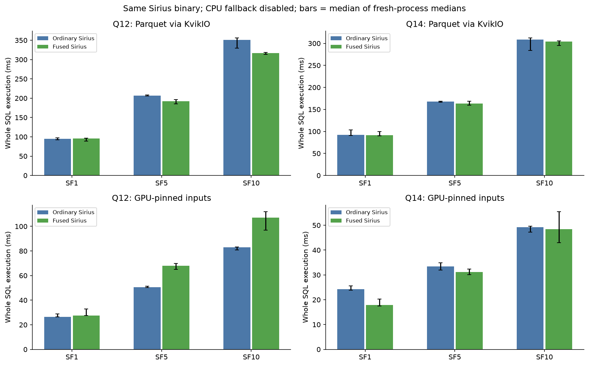
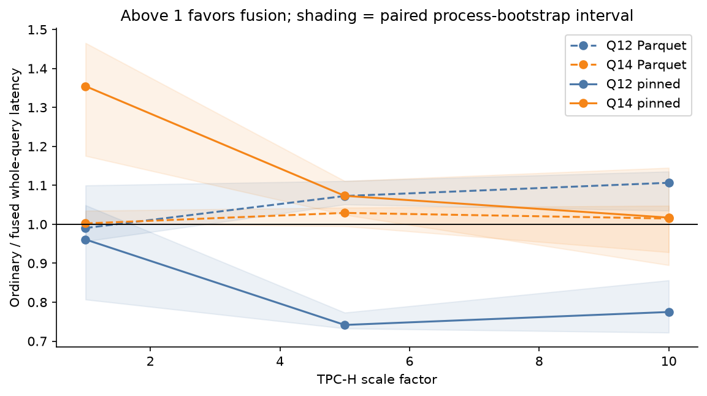
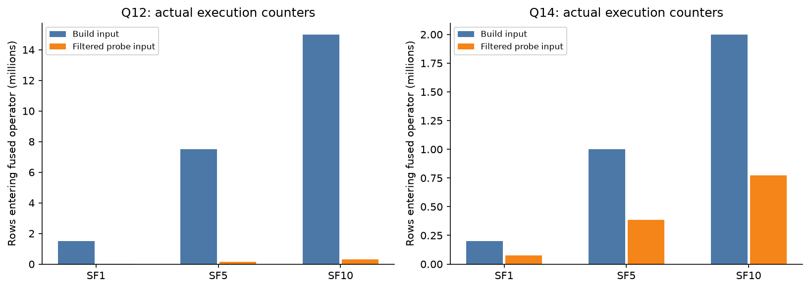
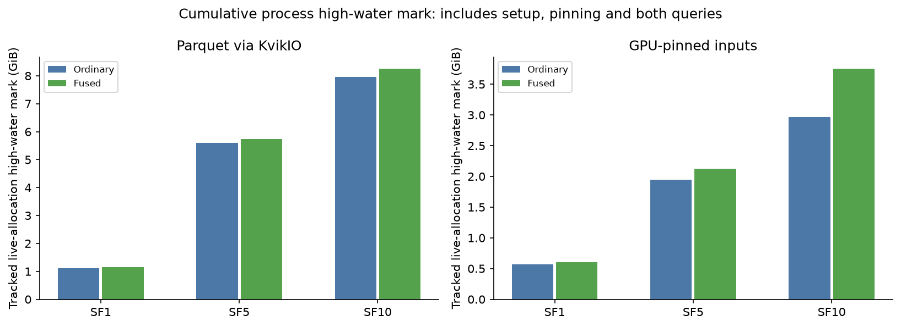
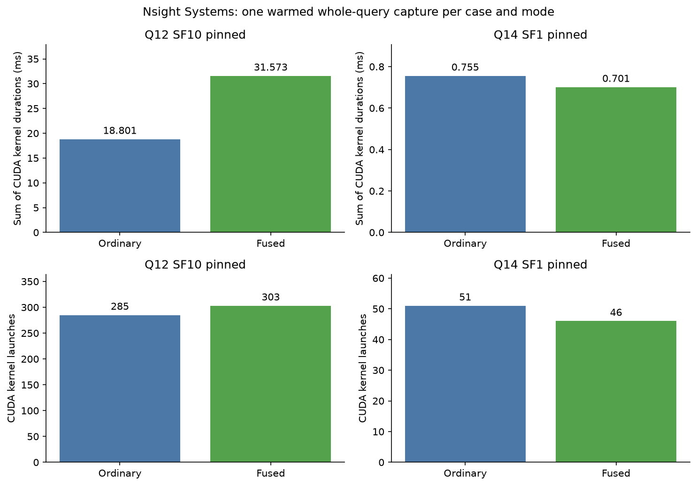
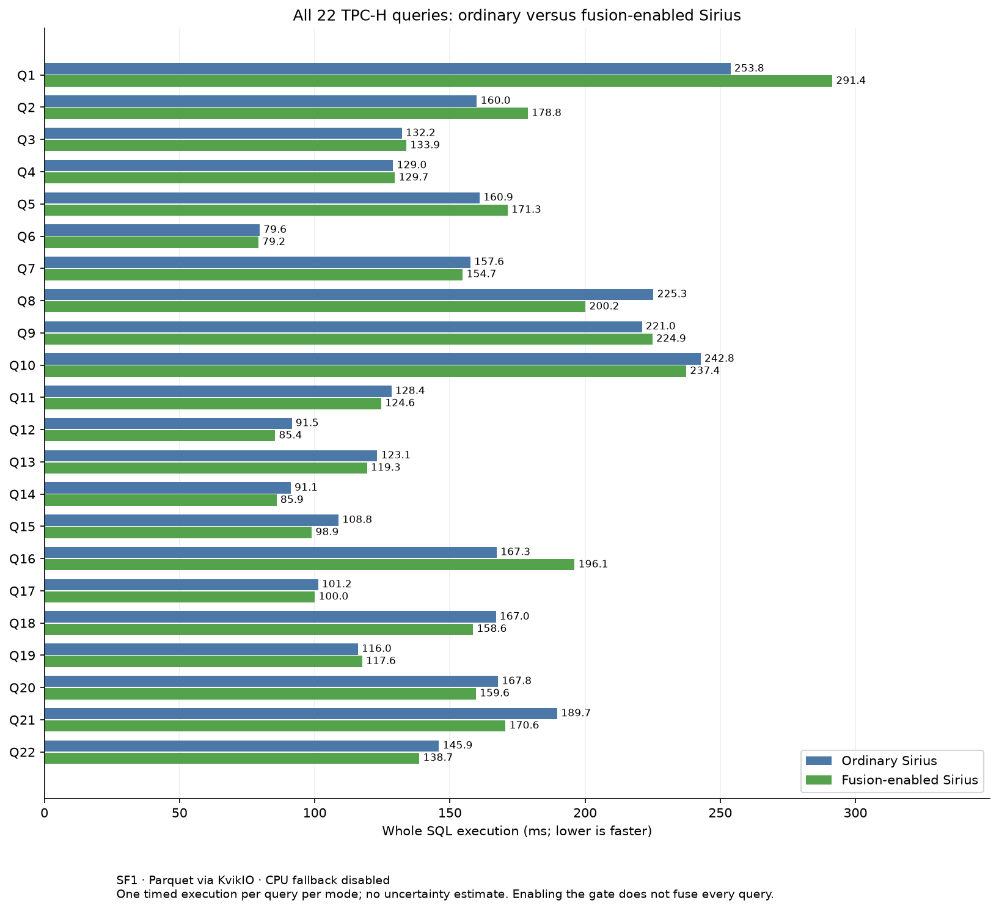
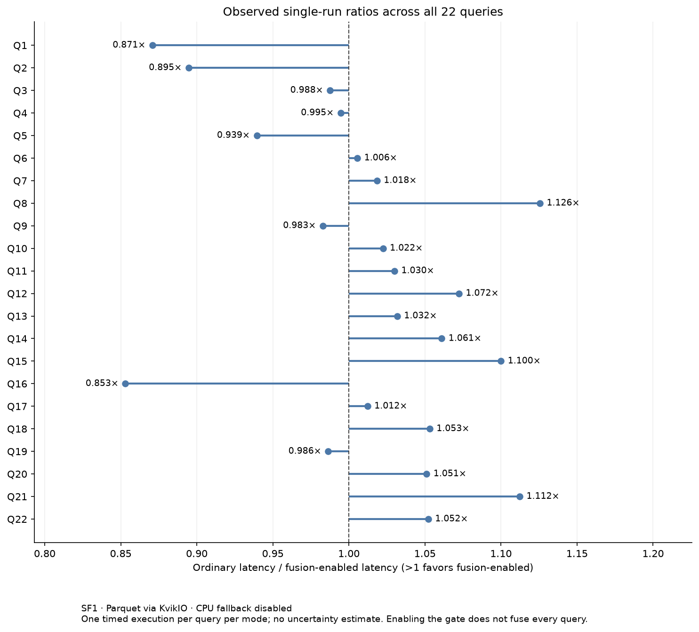

> Historical engine experiment with a forced build orientation. The revised study preserves the ordinary plan's build side; see [REPORT.md](REPORT.md).
> Correction discovered during the revision: the ordinary Q14 plan builds on part, not filtered lineitem. The historical explanation below overstated the Q14 orientation difference. The original measurements are retained unchanged.
Reference SQL/CPU fixtures are deduplicated in `results/reference_fixtures.json.gz`; see the [artifact guide](../README.md) for validation and restoration. Generated datasets and superseded pilots were removed during cleanup.


# Fused join and aggregation inside Sirius, using KvikIO

The full Sirius executable and DuckDB extension were built and exercised. **All 22 TPC-H queries pass at SF1 with CPU fallback disabled, both with the research fusion gate off and on.** The focused Q12/Q14 performance campaign contains 360 measured whole-query executions across SF1, SF5 and SF10, using the same engine binary. KvikIO compatibility I/O handles local Parquet reads despite this container denying io_uring setup.

The result is mixed. GPU-pinned Q14 at SF1 improves from 24.22 to 17.88 ms (1.354×); that advantage largely disappears at SF10. GPU-pinned Q12 regresses from 50.47 to 68.05 ms at SF5 and from 83.04 to 107.16 ms at SF10. With Parquet scans included, Q12 SF10 improves from 350.65 to 316.89 ms (1.107×), while Q14 changes little. This prototype therefore does **not** justify enabling fusion by default.

No pre-aggregation implementation or comparison is included. Every matching join pair is visited and contributes its aggregate value after matching.

## What actually ran

Branch: `research/fused-join-aggregation`, based on main commit `83d6c0ee01f2a98b97ce04c74141e2881f49438e`.

The actual build includes `build/release/libsirius.so.0.0.0`, the DuckDB executable at `sirius-duckdb/build/release/duckdb`, and its Sirius extension. The measurement harness uses the root environment's DuckDB 2.0 Python API to load that extension, which links to the installed Sirius library. It executes normal SQL through the Sirius planner, scans, scheduler and operators; it does not invoke the standalone CUDA harness.

The final library SHA-256 is `72fe2826f1c6e62e324ecb058a4bd100a094ea17abe03d19cdcce477fcf79308`. Every one of the 36 primary measurement processes records this same hash. [Campaign metadata](results/sirius_initial/campaign.json), per-process `environment.json` files and [raw measurements](results/sirius_initial/end_to_end.csv) retain the evidence.

KvikIO support had been removed upstream. This branch restores it as an explicitly selected local-file backend in Sirius and cuCascade. The cuCascade gitlink remains pinned at its original commit; its required local changes are preserved in [cucascade-kvikio.patch](cucascade-kvikio.patch), including the restored implementation files. Reproduction must apply that patch; a clean, unpatched submodule cannot reproduce this build. The build script applies it. `backend: kvikio` plus `KVIKIO_COMPAT_MODE=ON` selects POSIX compatibility I/O rather than requiring GPUDirect Storage. These measurements are not GDS measurements. Remote URLs retain the existing native backend.

The experimental planner rewrite is controlled by `SIRIUS_EXP_JOIN_AGGREGATION=0/1` and is off by default. It replaces an admitted inner equijoin, projection and SUM aggregation with `FUSED_JOIN_AGGREGATE`. It evaluates supported expressions using Sirius, builds a chained hash table, visits every matching pair, and combines warp partial sums into decimal128/HUGEINT outputs. It handles the tested Q12 conditional sums and Q14 promotional/total revenue sums. Q14's final ratio still runs in Sirius above the fused node.

The operator reuses the existing dense-count operator's two-input scheduling interface, but overrides its execution: no key-count histogram or multiplicity multiplication implements the experiment. Both inputs must arrive before it executes. The prototype supports one GPU, one partition, supported integer keys, at most four groups and a limited SUM/expression shape. Unsupported plans retain ordinary Sirius operators. This is an opt-in research implementation, not a general production SQL optimization.

## Experimental design

- GPU: NVIDIA RTX 5060 Ti, 16,311 MiB; driver 595.99.02. CUDA 12.9.86, cuDF 26.10.02, RMM 26.10, native `sm_120` build.
- Genuine TPC-H SF1/SF5/SF10 data generated with DuckDB 1.4 in the separately locked experiment environment, then exported to Snappy Parquet with 122,880-row groups. SF10 has 59,986,052 lineitems. Data uses approximately 11 GB, within the supplied 100 GB budget.
- Actual engine SQL comes from `test/tpch_performance/queries.py`, including its scale-dependent parameters. For example, its Q14 uses August 1994. The older standalone appendix used September 1995; its absolute times and row counts are not directly comparable.
- **Ordinary:** full Sirius with the research gate off. **Fused:** identical binary and settings, gate on. `gpu_execution=true` and `enable_duckdb_fallback=false` are set and asserted. Execution logs confirm fused operator execution in every requested focused run and its absence from the ordinary arm.
- **Parquet:** scan/decode/transfer through KvikIO is inside each execution. No deliberate OS page-cache eviction is performed, so this is a warmed filesystem workload, not a cold-disk throughput test.
- **GPU-pinned:** Sirius `pin_table` loads the union of Q12/Q14 required columns before timing. At SF10 the retained tracked allocation after pinning is about 2.03 GiB. It does not pin every column in every table. KvikIO performs the initial load; repeated queries use Sirius's resident data.
- Each configuration has three independent fresh-process trials. Each process runs two warmups followed by five measured repetitions for each query. Modes run A/B, B/A, A/B across trials. All GPU runs are serial; two engine processes cannot safely share this device's available allocation budget.
- Timed interval: `execute(sql).fetchall()`, including query planning, scans or resident scans, hash construction, expressions, scheduling, aggregation and result retrieval. Extension startup, view creation, CPU reference computation, pinning and data generation are outside the interval. Pinning duration is recorded separately.
- Both arms use the same [configuration](sirius-kvikio.yaml): four scan/pipeline threads, one GPU, dynamic filters disabled, no scan cache/readahead, and normal INFO logging. These settings are controlled experimental choices, not default-engine tuning claims.
- Each point is the median of three process medians, each based on five repetitions. Error bars show their minimum/maximum. Speedup intervals bootstrap the three paired process medians with a fixed seed. Three independent processes are few: treat these intervals as exploratory, not release-quality confidence bounds. No profiler runs contribute to the primary latency statistics.

These are research timings, not an official TPC-H score. All 22 queries are correctness coverage at SF1; the repeated performance matrix is Q12/Q14 at three scales, the shapes supported by this prototype.

## Figure 1: whole SQL latency depends on the input path



**Finding.** Q14 benefits at small scale with resident inputs, but its large-scale Parquet latency changes little. Q12 has opposite results depending on input residency: its SF10 Parquet execution improves by about 9.6% in latency, while its resident execution becomes about 29% slower.

**Explanation.** Scan, decode, transfer, filters and pipeline scheduling are significant parts of full-query time. Removing intermediate stages has a different effect in an overlapped scan pipeline than with already resident data. The fused operator also changes scheduling and hash-build orientation, so subtracting the pinned time from the Parquet time would not isolate I/O cost. The Q12 sign reversal demonstrates that the operator's local runtime cannot predict the full pipeline's result. The profiler and row counters below identify a specific added cost in the resident case; the current evidence does not uniquely attribute the entire Parquet improvement to one stage.

## Figure 2: speedup and process variation



**Finding.** The strongest observed gain is Q14 SF1 pinned, 1.354×. Q12 pinned at SF5/SF10 has a clear regression across these processes. Q14 SF10 is close to parity, with intervals crossing 1 for both input paths. The small apparent SF10 Q14 improvement is insufficient evidence of a reliable gain.

**Explanation.** At small scale, eliminating separate join/projection/aggregation pipelines can matter more than the kernel arithmetic it saves. As scale grows, hash construction and expression work increase and can consume that advantage. Process variation is especially visible in pinned Q14 SF10; the bootstrap reflects only these three process pairs, not variation across machines, days or clock policies.

| Query | SF | Input | Ordinary ms | Fused ms | Speedup | Process-bootstrap interval |
| --- | ---: | --- | ---: | ---: | ---: | --- |
| Q12 | 1 | Parquet | 95.14 | 96.06 | 0.990× | [0.956, 1.100] |
| Q12 | 5 | Parquet | 206.47 | 192.50 | 1.073× | [1.051, 1.111] |
| Q12 | 10 | Parquet | 350.65 | 316.89 | 1.107× | [1.035, 1.135] |
| Q14 | 1 | Parquet | 91.95 | 91.74 | 1.002× | [1.002, 1.035] |
| Q14 | 5 | Parquet | 168.10 | 163.33 | 1.029× | [0.995, 1.043] |
| Q14 | 10 | Parquet | 308.95 | 304.46 | 1.015× | [0.928, 1.048] |
| Q12 | 1 | pinned | 26.49 | 27.57 | 0.961× | [0.807, 1.049] |
| Q12 | 5 | pinned | 50.47 | 68.05 | 0.742× | [0.733, 0.773] |
| Q12 | 10 | pinned | 83.04 | 107.16 | 0.775× | [0.722, 0.856] |
| Q14 | 1 | pinned | 24.22 | 17.88 | 1.354× | [1.176, 1.465] |
| Q14 | 5 | pinned | 33.45 | 31.18 | 1.073× | [1.024, 1.111] |
| Q14 | 10 | pinned | 49.20 | 48.38 | 1.017× | [0.895, 1.145] |

## Figure 3: the prototype's build orientation is expensive



**Finding.** At SF10, fused Q12 builds 15,000,000 orders and probes 311,026 filtered lineitems, roughly 48 build rows per probe. Q14 builds 2,000,000 parts and probes 773,932 lineitems, about 2.6 build rows per probe.

**Explanation.** The experimental matcher requires the aggregate value/group expressions on the probe side and the CASE condition on the build side. It consequently fixes these orientations. Ordinary Sirius's captured plan instead builds on filtered lineitem and probes the other input. In Q12, the prototype also evaluates priority CASE predicates over all orders before matching, whereas the ordinary path evaluates aggregate expressions over joined rows. Those extra build rows and early expressions are prototype costs, not necessary properties of join/aggregation fusion.

The A/B experiment therefore measures an integrated optimization with a different hash structure, orientation, expression placement and scheduling. It does not isolate intermediate removal alone. A fair next implementation should preserve the ordinary plan's smaller build side while still evaluating every matching pair.

## Figure 4: eliminating joined rows does not guarantee a lower memory peak



**Finding.** At SF10 pinned, the tracked high-water mark rises from 2.96 GiB to 3.75 GiB, approximately 27%. In the Parquet campaign it rises from 7.97 to 8.26 GiB. Fusion increases this measurement at every tested scale.

**Explanation.** The fused node waits for both complete inputs and retains concatenated input data, hash state and evaluated expression columns. Its larger build side can outweigh removing joined-row intermediates. This contradicts any inference that the standalone harness's buffer reduction must produce a lower full-engine peak.

The statistic comes from Sirius's logged GPU resource adaptor. It is the **cumulative process high-water mark**, including setup, pinning, warmups and both queries, not a reset per-query or operator peak. Bars are medians across the three processes. It counts tracked live requests, excluding unused pool capacity, driver/context memory and allocations outside the tracked resource. It is not NVML process residency. [Extracted process measurements](results/sirius_initial/process_memory.csv) and each process's `operator_evidence.txt` retain the source values.

## Figure 5: full-query profiler evidence supports the build-cost diagnosis



**Finding.** In a warmed, pinned Q12 SF10 capture, summed CUDA kernel duration rises from 18.80 to 31.57 ms and launch count rises from 285 to 303. The fused hash-build kernel alone consumes 10.81 ms. Q14 SF1 shows a much smaller change: 0.755 to 0.701 ms and 51 to 46 launches.

**Explanation.** Fewer logical operators need not mean fewer kernels: input concatenation, expression evaluation, group encoding and reductions remain. Q12's enlarged hash build adds substantial device work. For Q14 SF1, the approximately 0.055 ms kernel-duration reduction is much smaller than the 6.34 ms primary whole-query improvement. This supports a contribution from reduced CPU/pipeline orchestration and synchronization; it does not measure an exact allocation of the wall-time saving to those causes.

Each capture covers one whole measured query after pinning and two warmups. Summed kernel durations can overlap across streams and are **not** query wall time or GPU utilization. These are diagnostic single captures, not repeated latency estimates. [Portable profiler summaries](results/sirius_initial/profile_summary.json), per-capture `*.kernels.txt` and `*.capture.txt` retain the evidence; raw Nsight captures are generated locally and ignored by Git.

Hardware counters remain unavailable (`ERR_NVGPUCTRPERM`). Nsight Systems, actual engine allocation logs and Compute Sanitizer were used without changing host permissions. No measured DRAM-traffic, bandwidth-saturation, occupancy or cache-hit claim is made.

## Figure 6: all 22 SF1 query execution times



**Finding.** The two complete SF1 validation runs have broadly similar query latencies. Q12 changes from 91.52 to 85.35 ms and Q14 from 91.14 to 85.90 ms. Other queries also move in both directions: Q1 rises from 253.79 to 291.44 ms, while Q8 falls from 225.29 to 200.16 ms. All 44 outputs match the independent CPU references.

**Explanation.** These are full SQL executions over Parquet through KvikIO, including scans, planning and scheduling. There is only one measured execution per query in each retained validation run, after one warmup. Differences can include process state, caches, device clocks and host scheduling as well as admitted planner changes. The fusion gate does not rewrite every query, so this chart compares two engine configurations; it does not show 22 independently fused operators. These observations cannot establish a suite-wide optimization benefit or regression. Use the repeated Q12/Q14 campaign above for stronger performance evidence.

## Figure 7: all-query ratios make the single-run variation visible



**Finding.** Ratios above one favor the fusion-enabled run. Q12 is approximately 1.072× and Q14 approximately 1.061× in these particular validation runs. The chart also contains deviations on other queries, with Q1 near 0.871× and Q8 near 1.126×.

**Explanation.** Dividing the latencies makes relative differences visible across queries with different runtimes. It does not remove timing noise or prove that the gate caused each difference. No error bars or significance claims are appropriate from one sample. In particular, the single-run Q12/Q14 ratios need not equal the three-process medians reported earlier. The same-color points deliberately avoid classifying these observations as reliable wins and losses.

Both plots are generated by [plot_all22.py](plot_all22.py) directly from the two linked all-query result files below. Exact plotted values are in [all22_comparison.csv](results/sirius_initial/all22_comparison.csv); this plotting step does not rerun SQL or change the measurements.

## Correctness and execution evidence

The frozen final binary passes all 22 queries in both gate configurations at SF1 against a separate CPU DuckDB connection. See [ordinary results](results/sirius_initial/final_all22_ordinary_sf1/results.json) and [gate-enabled results](results/sirius_initial/final_all22_fused_sf1/results.json). Enabling the gate does not fuse all 22 queries; unsupported shapes execute through ordinary Sirius operators. CPU fallback remains disabled throughout.

Every focused warmup and measured execution also matches the CPU result. Decimal and integer values compare exactly; floating values use relative tolerance 1e-10 and absolute tolerance 1e-7. SQL and complete CPU reference rows are retained per run, with large references gzip-compressed. The primary campaign contains 360 measured queries plus 144 warmup checks.

Five additional full-SQL fixtures cover duplicate build keys, negative and null values, null join keys, unmatched groups, empty joins, all-null sums and reversed SQL sides. A decimal sum exceeds the int64 unscaled range, checking decimal128 accumulation. [Fixture results](results/sirius_initial/semantics/results.json) match CPU exactly, and [Compute Sanitizer](results/sirius_initial/fused_sql_memcheck.txt) reports zero memory errors over all five. These are bounded checks, not exhaustive validation of arbitrary SQL. In particular, broader types, overflow behavior, arbitrary expressions/groups, multi-GPU execution and spilling require further work before production use.

## What to do next

Keep the gate off by default. First preserve the optimizer's smaller hash-build input and defer CASE evaluation until matching where semantics allow. Then measure whether joined-row removal pays for its state and scheduling costs. Also reduce full-input barriers/copies and repeat both Parquet and resident experiments, because the present results disagree across those modes. Extend type/null/overflow validation before widening planner admission. None of these steps requires pre-aggregation.

The useful outcome is a working full-engine experiment that exposes both wins and regressions, rather than a blanket speedup claim. The earlier [standalone report](STANDALONE_REPORT.md) remains an appendix with controlled same-hash comparisons and synthetic multiplicity/skew sweeps. Its kernels, numeric representation and timing boundaries differ, so its plots do not substitute for the full-engine figures above.

## Reproduction and artifacts

From the repository root, using the installed Pixi executable (`/root/.pixi/bin/pixi` on this machine):

```bash
pixi run -e cuda12 bash experiments/fused_join_aggregate/build_sirius_kvikio.sh
pixi run --manifest-path experiments/fused_join_aggregate/pixi.toml \
  python experiments/fused_join_aggregate/generate.py --scales 1 5 10
pixi run --manifest-path experiments/fused_join_aggregate/pixi.toml \
  python experiments/fused_join_aggregate/export_parquet.py --scales 1 5 10
pixi run -e cuda12 python experiments/fused_join_aggregate/run_sirius.py \
  --sf 1 --mode ordinary --name final_all22
pixi run -e cuda12 python experiments/fused_join_aggregate/run_sirius.py \
  --sf 1 --mode fused --name final_all22
pixi run -e cuda12 python experiments/fused_join_aggregate/test_sirius_fusion.py
pixi run -e cuda12 python experiments/fused_join_aggregate/measure_sirius.py
pixi run -e cuda12 bash experiments/fused_join_aggregate/profile_sirius.sh
pixi run -e cuda12 python experiments/fused_join_aggregate/summarize_sirius.py
pixi run --manifest-path experiments/fused_join_aggregate/pixi.toml \
  python experiments/fused_join_aggregate/plot_sirius.py
pixi run --manifest-path experiments/fused_join_aggregate/pixi.toml \
  python experiments/fused_join_aggregate/plot_all22.py
```

Run engine commands serially. The build script defaults to this GPU's architecture; override `SIRIUS_RESEARCH_CUDA_ARCH` on other hardware. The root lockfile controls engine dependencies; the experiment lockfile controls generation/plotting. Generated datasets, build products, full logs and raw profiler traces are ignored; compact evidence, references, measurements, and Python-generated PNG/SVG plots are retained. The five repeated-campaign figures are regenerated by [plot_sirius.py](plot_sirius.py), using [summarize_sirius.py](summarize_sirius.py) for portable profiling/memory extraction.
