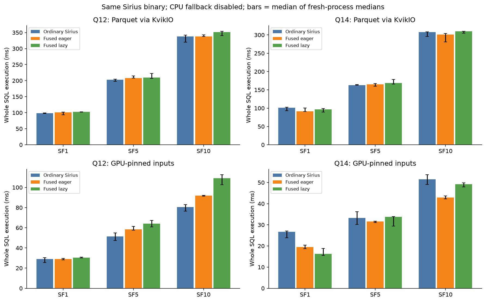
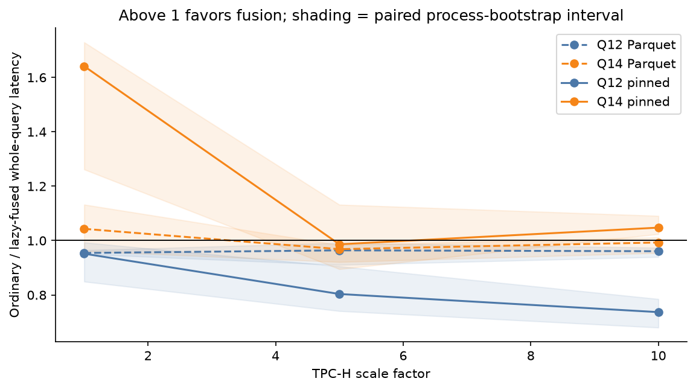
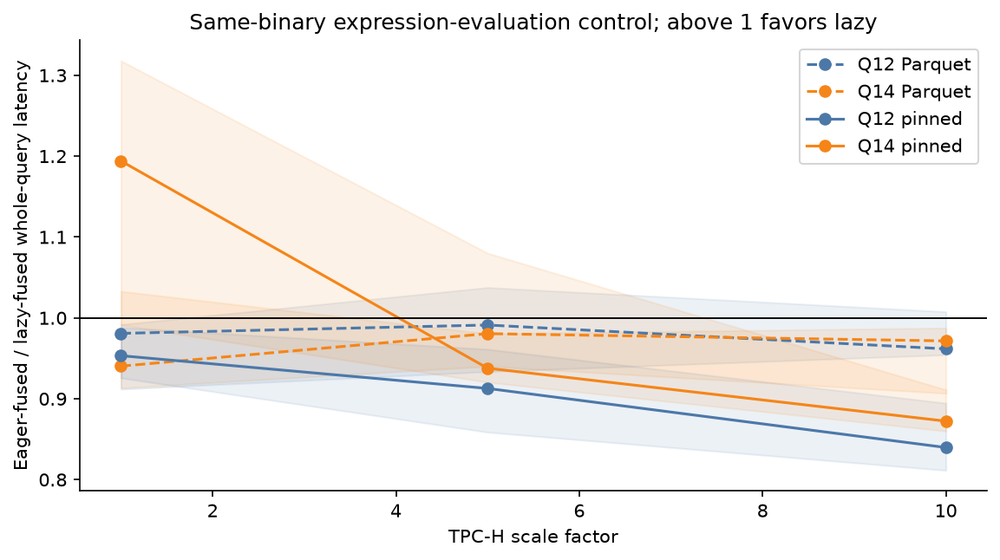
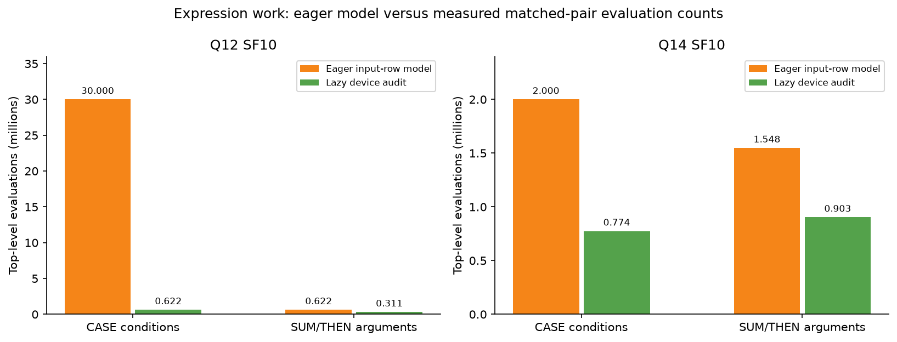
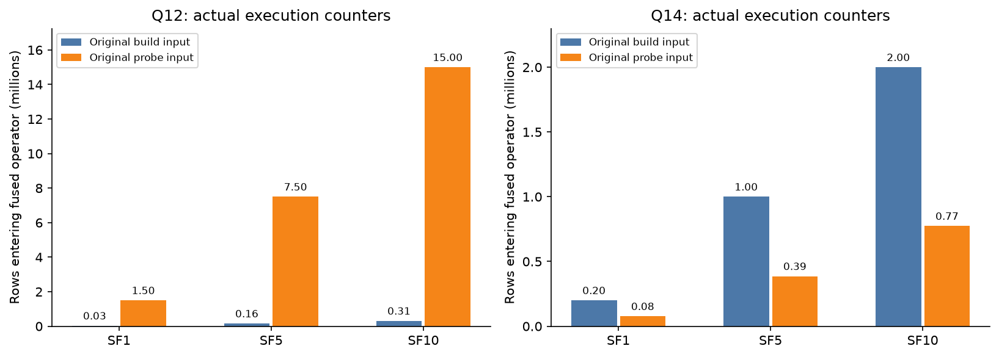
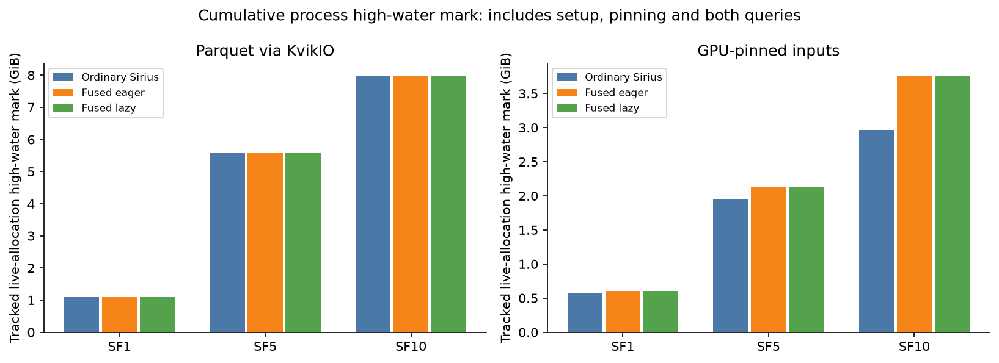
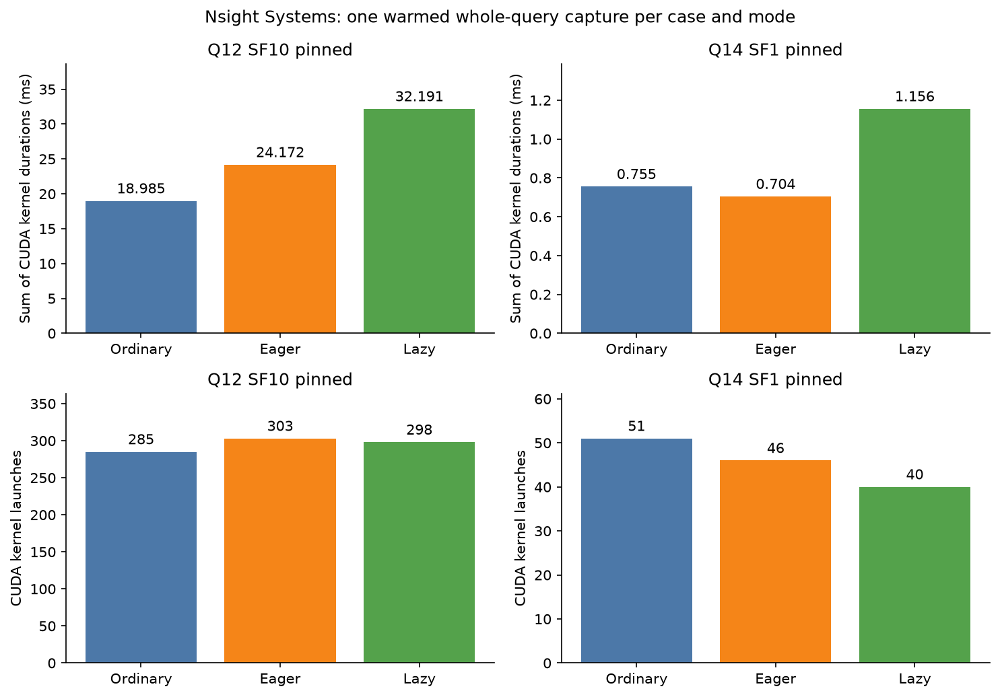
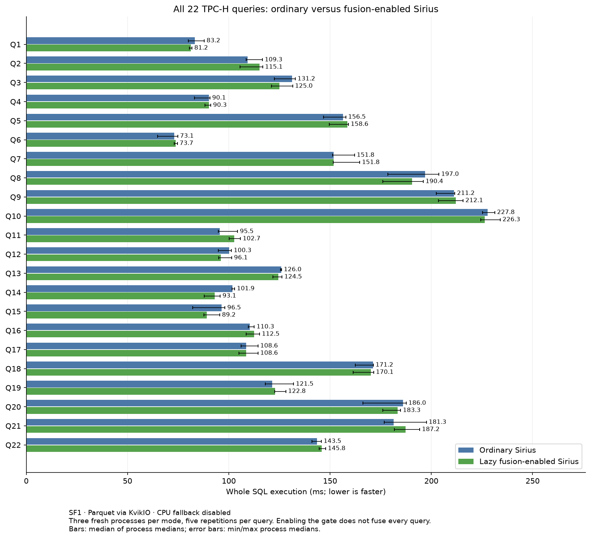
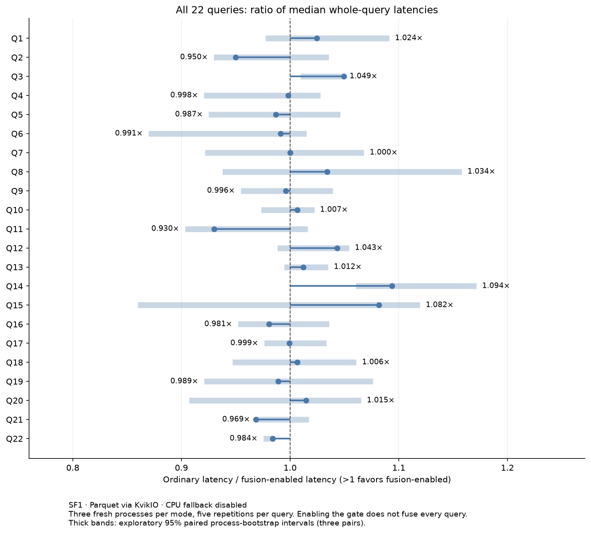

# Lazy fused join and aggregation inside Sirius

Reference SQL/CPU fixtures are deduplicated in `results/reference_fixtures.json.gz`; see the [artifact guide](../README.md) for validation and restoration. Generated datasets and superseded pilots were removed during cleanup.

The fused operator now evaluates SUM arguments and CASE conditions **after a successful equality match**, and evaluates a CASE's THEN argument only when its condition is true. It preserves ordinary Sirius's build/probe input identities. This is full Sirius SQL execution using KvikIO, with CPU fallback disabled; no pre-aggregation is implemented or compared.

The implementation skips the intended work, but is **not a general speedup**. At SF10 with GPU-pinned inputs, Q12 takes 80.50 ms ordinary, 91.73 ms eager-fused and 109.24 ms lazy-fused. Lazy is about 19% slower than eager despite far fewer predicate evaluations. Q14 SF1 pinned has a favorable lazy point estimate (16.30 versus 19.46 ms eager), but its eager/lazy process-bootstrap interval includes parity. The study reports negative results as well as favorable points.

## Implementation and evidence

A bounded scalar compiler translates the admitted Sirius ASTs into device instructions. The probe kernel loads values directly from the matching build/probe rows, applies SQL null handling, checks supported arithmetic bounds, and accumulates decimal128/HUGEINT sums. Lazy execution creates no whole-input SUM-argument or CASE-predicate columns and no joined-row intermediate. Unsupported scalar shapes retain the ordinary plan. Group-domain encoding, key casts and input concatenation remain preparation work; this revision does not defer every expression in the query.

The original plan's build input remains original child 1. At SF10, Q12 builds 311,026 filtered lineitems and probes 15 million orders; Q14 builds 2 million parts and probes 773,932 filtered lineitems. Q14's original build is part: the first report's claim that it built filtered lineitem was incorrect. The kernel selects a group per matching pair, so one order may contribute to several shipping-mode groups. It reuses the dense-count class's two-input scheduling interface, overriding its execution; no multiplicity histogram substitutes for visiting matches.

Three modes run with one compiled binary: ordinary (`SIRIUS_EXP_JOIN_AGGREGATION=0`), eager fused (gate on and `SIRIUS_EXP_JOIN_AGGREGATION_LAZY=0`) and lazy fused (gate on and lazy setting 1, the default). The eager mode is a same-binary control for expression-evaluation strategy. It is not a timing copied from the earlier campaign. Ordinary versus lazy still includes different hash implementations, expression evaluation, scheduling and intermediate removal; it does not isolate fusion alone.

An optional device audit counts actual top-level expression evaluations. It is enabled only in a separate correctness/diagnostic run and disabled during timing and profiling. [Audit evidence](results/sirius/lazy_audit_fused_sf10/operator_evidence.txt), per-query `operator_counts.json` and `plan_evidence.txt` retain execution proof. [Verification manifest](results/sirius/verification.json) records build hashes, coverage and source fingerprints.

## Setup and experimental design

- Branch `research/fused-join-aggregation`, based on main `83d6c0ee01f2a98b97ce04c74141e2881f49438e`. The actual library, DuckDB executable and extension were rebuilt. Python DuckDB 2.0 loads the extension and runs normal SQL through Sirius's planner, scans, scheduler and operators.
- NVIDIA RTX 5060 Ti, 16,311 MiB, driver 595.99.02; CUDA 12.9.86, cuDF 26.10.02 and RMM 26.10; native `sm_120`. Installed library SHA-256: `9bd1279582d68671dc8d608b98d31b164b29637e39a6158c3648984bba6bf851`.
- Genuine TPC-H SF1/SF5/SF10 generated with DuckDB 1.4 in the separately locked experiment environment, then exported to Snappy Parquet with 122,880-row groups. SF10 has 59,986,052 lineitems; data occupies about 11 GB, within the supplied 100 GB budget. SQL is from `test/tpch_performance/queries.py`; Q14 uses August 1994.
- KvikIO is restored in Sirius and cuCascade. The cuCascade gitlink stays pinned, with the required changes preserved in [cucascade-kvikio.patch](cucascade-kvikio.patch). The build script applies it. `backend: kvikio` and `KVIKIO_COMPAT_MODE=ON` use POSIX compatibility I/O despite denied io_uring setup. These are not GPUDirect Storage measurements.
- All modes use [the same configuration](sirius-kvikio.yaml): one GPU, four scan/pipeline threads, dynamic filters disabled, no scan cache/readahead, INFO logging, `gpu_execution=true` and `enable_duckdb_fallback=false`. The fusion gate remains off by default.
- The focused campaign measures Q12/Q14 at three scales in two input modes, with three fresh processes per mode and five repetitions after two warmups: **540 measured executions**. Three-mode order rotates across trials. A separate ordinary/lazy all-22 SF1 Parquet campaign adds **660 measured executions**, with A/B, B/A, A/B mode order. All GPU work runs serially.
- Parquet timings include KvikIO reads, decode and transfer, with no deliberate OS page-cache eviction. GPU-pinned timings load the union of needed Q12/Q14 columns before measurement; SF10 retains about 2.03 GiB after pinning. Startup, pinning, view creation and independent CPU reference computation are excluded. Timed interval is `execute(sql).fetchall()`, including planning, the complete execution pipeline and result retrieval.
- Points are medians of three process medians. Latency error bars show min/max process medians. Ratio intervals bootstrap three paired process medians with a fixed seed. Three pairs provide exploratory evidence only; clocks are not locked and host activity can vary. Debug/audit/profiler runs do not contribute to the primary statistics. These are research measurements, not an official TPC-H score.

## Figure 1: whole-query latency in all three modes



**Finding.** Q12 is slower with lazy evaluation in every focused configuration by point estimate. Its resident SF10 latency rises from 91.73 to 109.24 ms relative to eager fusion. Q14 SF1 resident falls from 19.46 to 16.30 ms, while Q14 SF10 rises from 42.91 to 49.19 ms. Both input paths and all scales are shown rather than selecting only the favorable case.

**Explanation.** Deferring expressions saves whole-column preparation and temporary arrays, but moves work into random-access join probing. The bounded interpreter, decimal checks and matched-row string loads have costs. Scans, concatenation, key preparation, grouping and scheduling remain. Whole-query latency reflects the balance of these costs, not expression counts alone. Including Parquet reads can dilute or change an advantage observed with resident inputs because pipeline overlap differs.

| Query | SF | Input | Ordinary ms | Eager fused ms | Lazy fused ms | Ordinary/lazy | Eager/lazy | Process-bootstrap ordinary/lazy |
| --- | ---: | --- | ---: | ---: | ---: | ---: | ---: | --- |
| Q12 | 1 | Parquet | 98.12 | 100.83 | 102.80 | 0.954× | 0.981× | [0.950, 0.965] |
| Q12 | 5 | Parquet | 202.47 | 208.17 | 210.02 | 0.964× | 0.991× | [0.911, 0.991] |
| Q12 | 10 | Parquet | 337.61 | 337.90 | 351.36 | 0.961× | 0.962× | [0.940, 0.974] |
| Q14 | 1 | Parquet | 101.16 | 91.19 | 96.98 | 1.043× | 0.940× | [0.961, 1.132] |
| Q14 | 5 | Parquet | 163.14 | 165.18 | 168.46 | 0.968× | 0.981× | [0.921, 0.984] |
| Q14 | 10 | Parquet | 307.88 | 301.22 | 310.05 | 0.993× | 0.972× | [0.954, 1.012] |
| Q12 | 1 | pinned | 29.03 | 29.07 | 30.50 | 0.952× | 0.953× | [0.849, 0.993] |
| Q12 | 5 | pinned | 51.43 | 58.42 | 64.01 | 0.804× | 0.913× | [0.741, 0.905] |
| Q12 | 10 | pinned | 80.50 | 91.73 | 109.24 | 0.737× | 0.840× | [0.680, 0.785] |
| Q14 | 1 | pinned | 26.75 | 19.46 | 16.30 | 1.641× | 1.194× | [1.262, 1.729] |
| Q14 | 5 | pinned | 33.26 | 31.63 | 33.72 | 0.986× | 0.938× | [0.895, 1.132] |
| Q14 | 10 | pinned | 51.53 | 42.91 | 49.19 | 1.048× | 0.872× | [1.024, 1.091] |

## Figure 2: ordinary versus lazy fused



**Finding.** Ordinary/lazy Q12 resident SF10 is 0.737× with an exploratory interval [0.680, 0.785], favoring ordinary Sirius. Q14 resident SF1 is 1.641× [1.262, 1.729], while its SF10 advantage over ordinary is much smaller, 1.048× [1.024, 1.091]. Large-scale Parquet gains are absent or inconclusive in this campaign.

**Explanation.** The ordinary path uses cuDF hash joining and separate aggregate processing, while the prototype combines matching and accumulation using its own hash table. A ratio above one is a full-implementation result, not a controlled measure of saved intermediate writes. The shaded intervals describe these three process pairs, not uncertainty across GPUs or software versions.

## Figure 3: eager versus lazy fused, using the same binary



**Finding.** Q12 resident SF10 has eager/lazy speedup 0.840× [0.811, 0.895], favoring eager execution. The only focused point estimate above one is Q14 SF1 resident: 1.194×, with an interval [0.991, 1.318] that includes parity. This does not establish a reliable incremental lazy benefit even in that favorable small case.

**Explanation.** Both fused modes preserve the same input roles and aggregation strategy. The eager mode evaluates columns with Sirius/cuDF before probing; the lazy mode interprets bounded scalar programs on matched pairs and checks supported arithmetic errors there. This comparison tests the implemented evaluation strategies, including their overhead. Fewer evaluated rows need not beat coalesced whole-column operations, especially at small scale or with inexpensive predicates.

## Figure 4: how much expression evaluation was skipped



**Finding.** At SF10 Q12's device audit counts **622,052 CASE-condition evaluations and 311,026 THEN evaluations**. The eager code's input-row model is 30 million predicate entries and 622,052 argument entries. Q14 counts 773,932 predicates and 902,964 arguments, versus the eager model's 2 million and 1,547,864 respectively.

**Explanation.** Q12 skips aggregate expressions for unmatched orders; only one of its complementary CASE branches supplies a THEN value per matching pair. Q14 evaluates its part predicate only when a filtered lineitem matches, and skips promotional-revenue arithmetic when the predicate is false. Its unconditional total still needs every match's revenue. Orange bars are calculated input-row counts from the eager code, not measured device-instruction counts; green bars are measured top-level program calls. Neither counts DRAM traffic or primitive arithmetic instructions. Audit counters are disabled for all primary timings.

## Figure 5: build roles stay fixed



**Finding.** Q12's selective lineitem build grows from 30,912 rows at SF1 to 311,026 at SF10, while its orders probe grows from 1.5 to 15 million. Q14 retains its 200,000-to-2-million-row part build and filtered lineitem probe.

**Explanation.** Laziness changes when aggregate expressions execute, not the optimizer's input assignment or the number of hash lookups required. Every probe key is still looked up. The small Q12 build is useful, but does not eliminate traversal and per-group partial-state work. Exact CPU comparisons check that duplicate pairs and different groups remain represented.

## Figure 6: tracked allocation high-water marks



**Finding.** SF10 Parquet high-water marks are approximately 7.97 GiB in all three modes. With resident inputs they are 2.96 GiB ordinary and 3.75 GiB for both eager and lazy fusion. Removing eager expression columns did not reduce the measured process peak.

**Explanation.** Lazy execution removes whole-input argument/predicate columns, but retains concatenated inputs, keys, hash state, group encoding, partial sums and small instruction buffers. A peak dominated by another phase can remain unchanged even when some allocations disappear. These are cumulative process high-water marks from Sirius's tracked live allocation requests, including pinning, warmups and both focused queries. They exclude unused pool capacity and untracked driver/context allocations; they are neither per-operator peaks nor NVML residency. Values come from [process_memory.csv](results/sirius/process_memory.csv).

## Figure 7: full-engine CUDA profiling



**Finding.** In the pinned Q12 SF10 capture, summed CUDA kernel duration is 18.99 ms ordinary, 24.17 ms eager and 32.19 ms lazy; launch counts are 285, 303 and 298. The fused probe itself grows from 3.925 to 14.824 ms, outweighing removed expression work. Q14 SF1 has 0.755/0.704/1.156 ms and 51/46/40 launches respectively: fewer launches coexist with more GPU kernel time. Its favorable whole-query point estimate therefore cannot be explained by reduced GPU duration alone.

**Explanation.** The traces distinguish reduced expression-kernel launches from the lazy probe's added work. The interpreter and random matched-row accesses can move cost into one kernel even while total launches fall. Summed kernel durations may overlap across streams and are not query wall time or utilization; wall-time changes can also include host/pipeline overhead. These are separate single captures of warmed, pinned whole queries after two warmups, not the primary timing estimates. [Profile summary](results/sirius/profile_summary.json) and portable `*.kernels.txt` retain the data.

[Compiler resource declarations](results/sirius/lazy_kernel_resources.txt) show a 608-byte stack frame and 48 registers for the shared probe kernel. Both fused modes use that compiled kernel; these static declarations are not occupancy or local-memory-traffic measurements and do not isolate the cause of the runtime difference. The measured increase in probe time supports an implementation-overhead diagnosis, not a general claim that lazy evaluation is intrinsically slower.

Nsight Compute hardware counters remain unavailable (`ERR_NVGPUCTRPERM`). Nsight Systems, actual allocation logs and Compute Sanitizer provide evidence without changing host permissions. No measured DRAM-traffic, bandwidth, occupancy or cache-hit claim is made.

## Figure 8: repeated all-22 SF1 comparison



**Finding.** In this separate repeated SF1 Parquet suite, Q12 is 100.27 ms ordinary versus 96.11 ms lazy, and Q14 is 101.86 versus 93.14 ms. Every measured result and warmup matches CPU references. These point estimates differ from the focused campaign; they are retained separately rather than pooled.

**Explanation.** Actual operator counts show only Q12 and Q14 use the fused operator in this suite. Other queries retain ordinary Sirius operators in both configurations; their timing differences cannot be described as additional fusion wins. All-22 execution also has a different query/allocator/cache history than the focused campaign, so the two sets of point estimates need not coincide.

## Figure 9: relative all-query timings



**Finding.** All-query Q12 is 1.043× [0.988, 1.054], which includes parity; Q14 is 1.094× [1.060, 1.171]. An unchanged query such as Q15 also has a favorable point estimate, 1.082×, with a wide interval [0.860, 1.120]. This illustrates why mode-wide timing changes cannot all be attributed to fused execution.

**Explanation.** Ratios normalize different query runtimes; thick bands show exploratory paired process-bootstrap intervals. An interval excluding one for a query without a fused operator does not prove a plan-level fusion effect. Three process pairs provide limited estimates, and timing history can remain correlated. [all22_comparison.csv](results/sirius/all22_comparison.csv) retains exact plotted values.

## Correctness and practical limits

All **1,200 measured executions and 480 warmup executions** match an independent CPU DuckDB connection. Decimal/integer values compare exactly; floating results use relative tolerance 1e-10 and absolute tolerance 1e-7. Each process retains SQL, full CPU reference rows, metadata, execution markers and a compact physical plan. Large references are gzip-compressed. Additional all-22 SF1 validation runs pass in [ordinary](results/sirius/final_all22_ordinary_sf1/results.json), [eager](results/sirius/final_all22_eager_sf1/results.json) and [lazy](results/sirius/final_all22_fused_sf1/results.json) modes.

The [11 SQL semantic checks](results/sirius/semantics/results.json) cover duplicates, null keys/values, negative values, empty joins, missing groups, both group-column sides, decimal128 accumulation beyond int64, string prefix/IN predicates and three-valued logic. Two checks put an overflowing multiplication on an unmatched row or an unselected THEN branch and confirm it is skipped. Another requires a matched overflow to raise the lazy evaluator's own error. [Compute Sanitizer](results/sirius/fused_sql_memcheck.txt) reports zero memory errors.

This remains an opt-in, single-GPU, single-partition research operator with at most four non-null groups and a restricted SUM/CASE shape. Scalar programs have at most 32 instructions and a 16-entry stack; numeric arguments are signed integers through 64 bits or decimals through precision 18, with decimal128 sum state. Supported expressions include widening casts, add/subtract/multiply, equality/inequality, AND/OR/NOT/IN and bounded string equality/prefix forms. General wildcard patterns, narrowing casts, arbitrary SQL expressions, wider scalar arithmetic, spilling and multi-GPU execution require further work. Passing the bounded checks is not general SQL conformance.

The [earlier eager report](EAGER_ENGINE_REPORT.md), [its source snapshot](eager_operator/README.md), [first engine report](INITIAL_ENGINE_REPORT.md) and [standalone appendix](STANDALONE_REPORT.md) remain historical artifacts. Their separately collected timings are not used as the eager control here. The useful next step is to assess interpreter/probe overhead and remaining input/barrier costs using the same-binary evidence, without assuming that saved evaluations guarantee a whole-query improvement.

## Reproduction

Run from the repository root with Pixi (`/root/.pixi/bin/pixi` here), serializing GPU commands:

```bash
pixi run -e cuda12 bash experiments/fused_join_aggregate/build_sirius_kvikio.sh
pixi run --manifest-path experiments/fused_join_aggregate/pixi.toml \
  python experiments/fused_join_aggregate/generate.py --scales 1 5 10
pixi run --manifest-path experiments/fused_join_aggregate/pixi.toml \
  python experiments/fused_join_aggregate/export_parquet.py --scales 1 5 10
pixi run -e cuda12 compute-sanitizer --tool memcheck --error-exitcode 86 \
  python experiments/fused_join_aggregate/test_sirius_fusion.py
pixi run -e cuda12 python experiments/fused_join_aggregate/run_sirius.py \
  --sf 10 --mode fused --queries 12 14 --pin --audit --name lazy_audit
pixi run -e cuda12 python experiments/fused_join_aggregate/measure_sirius.py
pixi run -e cuda12 python experiments/fused_join_aggregate/measure_sirius.py --all22
pixi run -e cuda12 bash experiments/fused_join_aggregate/profile_sirius.sh
pixi run -e cuda12 python experiments/fused_join_aggregate/summarize_sirius.py
pixi run --manifest-path experiments/fused_join_aggregate/pixi.toml \
  python experiments/fused_join_aggregate/plot_sirius.py
pixi run --manifest-path experiments/fused_join_aggregate/pixi.toml \
  python experiments/fused_join_aggregate/plot_all22.py
```

After a diagnostic run, [collect_sirius_evidence.py](collect_sirius_evidence.py) extracts portable evidence from its result folder; the measurement harness calls it automatically. The build defaults to `sm_120`; override `SIRIUS_RESEARCH_CUDA_ARCH` for another GPU. Root and experiment lockfiles control engine and plotting dependencies respectively. Generated data, binaries, raw logs and profiler captures are ignored; measurements, references, execution evidence and Python-generated PNG/SVG plots are retained.
