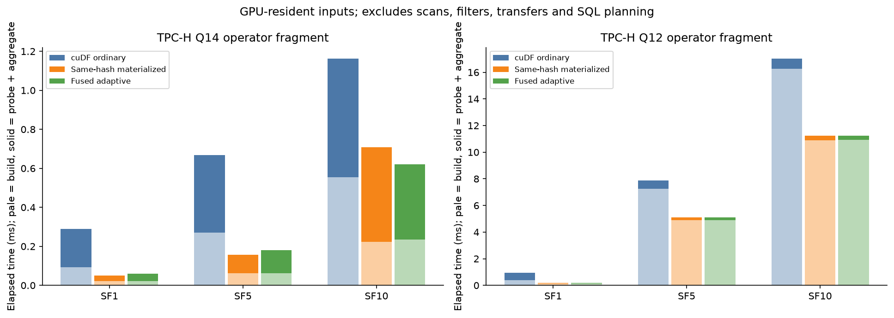
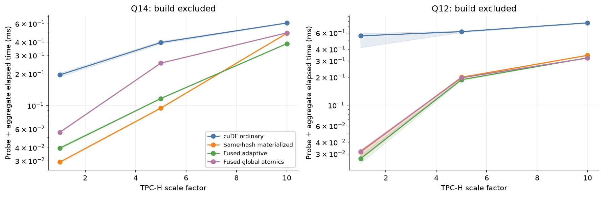
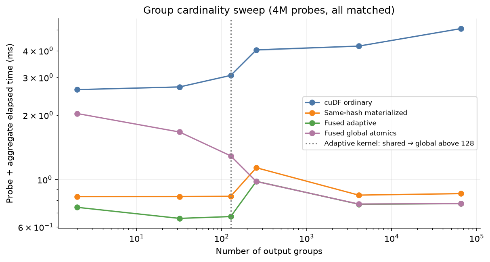
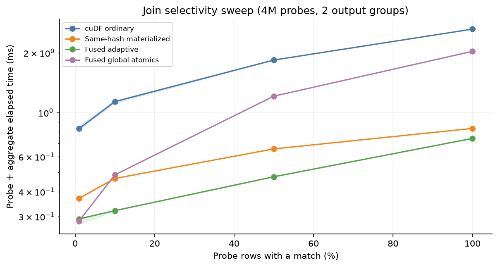
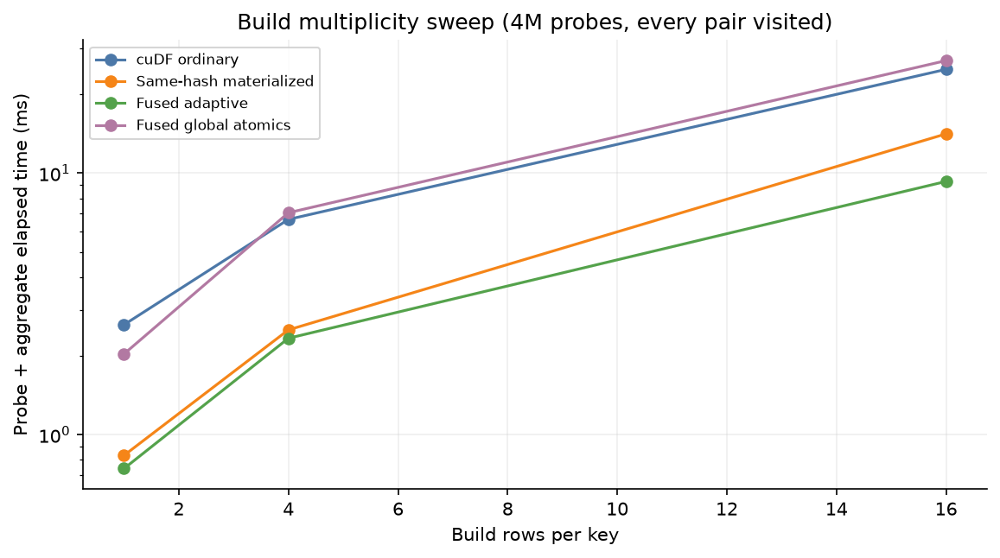
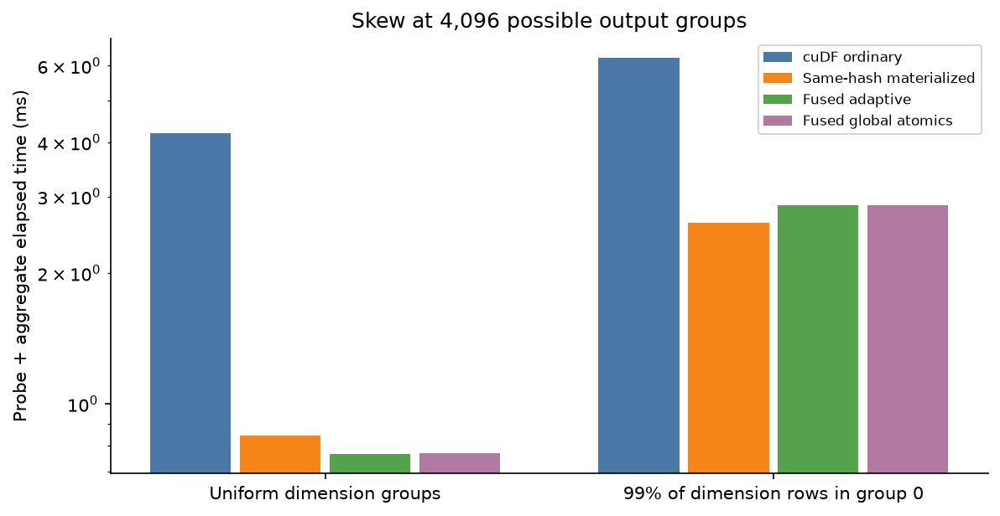
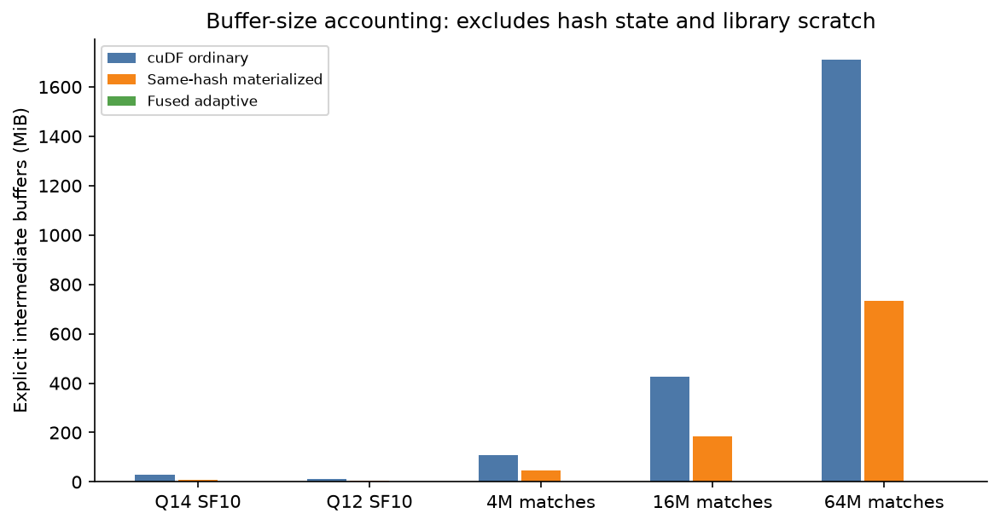
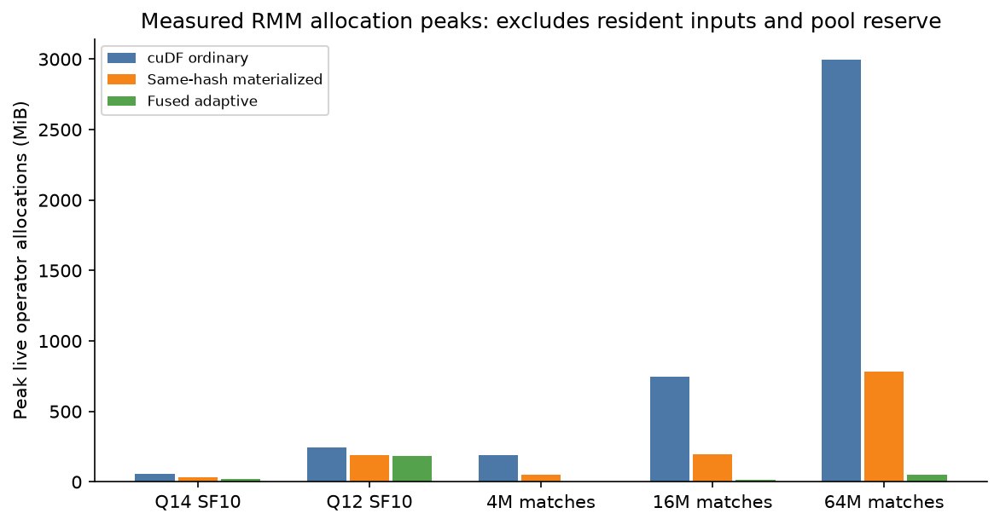

> Historical standalone operator appendix. The completed full-engine investigation and conclusions are in [REPORT.md](REPORT.md). Its timing boundaries, query parameters and kernels differ from this appendix; do not interpret these figures as whole-Sirius query results.

Reference SQL/CPU fixtures are deduplicated in `results/reference_fixtures.json.gz`; see the [artifact guide](../README.md) for validation and restoration. Generated datasets and superseded pilots were removed during cleanup.

# Fusing GPU join probing with aggregation

## What this experiment establishes

A fused operator is worth investigating, but **removing the intermediate is not an unconditional win**. On this RTX 5060 Ti, the standalone prototype beats the ordinary cuDF path on every measured TPC-H fragment. The stronger comparison, against a materialized implementation with the **same hash table and aggregation strategy**, shows much smaller gains and several regressions.

At SF10, Q14's probe-and-aggregate fragment improves by about 1.25× against that control; including hash construction reduces the improvement to about 1.14×. With orders fixed as its build side, Q12 improves by about 1.06× in the probe fragment but only about 1.000× with construction included. Q14 SF1/SF5 and the skewed-group workload regress against the same-hash control. Large duplicate output increases the benefit: the 64-million-match case improves by about 1.52× in probing.

**These are operator experiments, not Sirius SQL query speedups.** The executable links against real cuDF but does not call the Sirius planner, scheduler, scan subsystem, or operators. It uses selected columns and already filtered, GPU-resident inputs. Revenue arithmetic and category/priority encoding are prepared once for both methods and are outside the measured interval. No pre-aggregation strategy or rewrite is implemented or compared. Every duplicate match is visited individually.

## Setup and reproducibility

- Branch: `research/fused-join-aggregation`, based on Sirius `83d6c0ee`.
- GPU: NVIDIA GeForce RTX 5060 Ti, 16,311 MiB, 180 W limit; driver 595.99.02.
- Compiler/runtime dependencies: Pixi's CUDA 12.9.86, native `sm_120` cubin, cuDF 26.10.02, RMM 26.10.00; C++20, `-O3`, no fast-math flag.
- Data: genuine DuckDB-generated TPC-H SF1, SF5, SF10; approximately 5 GiB including all three compressed databases and extracted/synthetic inputs. The 100 GB budget did not require generating a larger dataset to expose the mechanisms tested here.
- TPC-H data generation and independent SQL references use DuckDB 1.4 from the experiment's separately locked Pixi environment. That is distinct from the repository's DuckDB 2.0 build dependency.
- Nineteen input cases; three warmup rounds, then fifteen measured rounds per case. Each round shuffles method order with a fixed seed. All methods run serially on one GPU.
- Every warmup and measured execution checks the entire output. TPC-H references come from DuckDB SQL; synthetic references use independent NumPy accumulation. The small fixture includes duplicates, misses, negative values, and a partial final CUDA block. Compute Sanitizer memcheck reports zero errors for that fixture across all four methods.
- Plotted values are medians of CUDA-event elapsed intervals; curve shading is the interquartile range. These intervals include stream idle time caused by host orchestration, allocations and synchronization, not just active kernel time. Raw CSV also contains host wall-clock measurements.
- Timing starts after input upload. Hash build and probe-plus-aggregate are timed separately. Output download, reference checks, hash destruction, SQL parsing, scans, string predicate evaluation, filtering, and host/device input transfers are excluded. "Total" below means **build plus this operator fragment**, not whole-query latency.
- Both implementations allocate through the same RMM pool. Warmups allow pool growth. Inputs are retained across rounds; neither path retains its hash table across rounds. Probe-only measurements therefore describe reuse of a built table, while totals include rebuilding it.
- This is one process per input on one consumer GPU, with warm resident inputs. The confidence intervals describe variation within that run, not hardware-to-hardware or process-to-process uncertainty. Clock locking and exclusive host-level GPU ownership were unavailable. The final primary measurements were collected after task-local data generation, compilation and profiling had finished; unrelated host activity can still affect orchestration. A fresh isolated run is required before making a release performance claim.

Exact package versions, compiler details, executable/source hashes, and GPU metadata are in [environment.json](results/environment.json). Raw trials, reference SQL, result metadata, numerical summaries, and paired-bootstrap speedup intervals are in [results/](results/).

## Compared implementations

| Label | Implementation | Purpose |
| --- | --- | --- |
| cuDF ordinary | `cudf::hash_join`, gather probe/dimension payloads, project aggregate inputs, then cuDF scalar reductions or groupby | A real library baseline using the materialization pattern present in Sirius |
| Same-hash materialized | Custom chained hash table; probe every matching pair into `(group, value)` arrays; launch a separate aggregate kernel | Control for hash-table design and aggregation strategy |
| Fused adaptive | Same custom hash table; probe every pair and immediately update aggregate state | Isolate intermediate removal against the control |
| Fused global atomics | Same fused traversal, one global atomic per matching pair | Show the cost of a naive accumulation strategy |

The adaptive kernel uses a block-local shared-memory histogram for up to 128 bounded group IDs and flushes block totals to global state. Above 128 groups it uses global atomics. The materialized control uses the same threshold and reducer. Both retain integer group IDs and int64 sums. This is aggregation **after a successful join match**, not aggregation of an input before joining.

The custom hash is a bucket-head/linked-row structure with a power-of-two bucket count at least twice the build-row count. cuDF uses its own CSR-based hash join. Consequently, **the cuDF-to-fused ratio combines fusion, hash implementation, expression handling, and aggregation differences**. Only the same-hash comparison controls the hash design. Even that control has a known limitation: it reserves a fixed maximum number of match slots per probe. At low selectivity it writes/scans invalid slots; cuDF produces compact match maps. For the TPC-H fragments, all foreign keys match and the bound is exactly one, so there are no unused match slots.

Q14 uses the original September 1995 ship-date filter, the part-key join and promo classification. Ordinary execution computes total and promotional revenue with two cuDF scalar sums. The fused kernel accumulates promo/nonpromo bins and reconstructs the same ratio. Revenue is represented exactly as `price_cents * (100 - discount_percent)`, with scale 10,000; the ratio is checked against the original decimal SQL result. All tested sums fit int64. Q12 uses its original shipping/date predicates, order-key join, and two conditional counts grouped by MAIL/SHIP. Its ordinary implementation uses two cuDF SUM requests grouped by shipping mode; fused execution uses four encoded count states.

The prototype is restricted to non-null int32 equality keys, bounded encoded groups, and int64 SUM/count states known to fit. It does not implement general SQL nullability, empty-scalar validity, decimal128 accumulation, overflow detection, outer joins, distinct aggregates, arbitrary expressions, memory spilling, or multiple GPUs. Those restrictions are material when planning a Sirius implementation.

| Fragment | cuDF probe (ms) | Control probe (ms) | Fused probe (ms) | Control/fused probe | Control/fused including build |
| --- | ---: | ---: | ---: | ---: | ---: |
| q14_sf1 | 0.1956 | 0.0292 | 0.0395 | 0.739× | 0.827× |
| q14_sf5 | 0.3964 | 0.0947 | 0.1167 | 0.811× | 0.872× |
| q14_sf10 | 0.6075 | 0.4852 | 0.3870 | 1.254× | 1.143× |
| q12_sf1 | 0.5573 | 0.0314 | 0.0266 | 1.178× | 1.020× |
| q12_sf5 | 0.6178 | 0.2000 | 0.1880 | 1.064× | 1.001× |
| q12_sf10 | 0.7685 | 0.3436 | 0.3235 | 1.062× | 1.000× |

Ratios above one favor fusion; ratios below one favor the control.

## Figure 1: including construction changes the conclusion



**Finding.** Q14's total operator time benefits from fusion at SF10 against the same-hash control, but regresses at SF1 and SF5. Q12, with orders fixed as the build side in this harness, is dominated by hash construction at SF5/SF10; its probe improvement barely changes total latency. At SF10, the custom Q12 build is roughly 10.9 ms while the fused probe is roughly 0.32 ms.

**Why.** The predicates leave only about 31,000 Q12 lineitems per scale factor, yet this experiment builds all 1.5 million orders per scale factor. Fusion removes probe-output work without removing that build. For Q14, the smaller part dimension and higher retained probe fraction leave more room for the probe fragment to matter. The visible cuDF/custom build difference is independent of fusion: all custom variants use the same construction kernel. These build sides are controlled choices, not verified Sirius plan choices. An optimizer may instead build the much smaller filtered lineitem input, especially in Q12. Sirius dynamic filters, join orientation, batching, or projecting fewer build rows could change these proportions; this figure cannot establish the engine's actual build share or justify deprioritizing Q12 without its GPU plan.

The bars stack separate build/probe medians for readability; exact per-round-total medians are in `summary.json` and can differ slightly from the sum of medians.

## Figure 2: probe speedups and the importance of the control



**Finding.** The cuDF baseline is slower than fused execution for these fragments, sometimes by a large factor. That headline hides the more modest same-hash result. At SF10 the controlled probe improvement is approximately 1.25× for Q14 and 1.06× for Q12. At Q14 SF1 and SF5, fused execution is about 35% and 23% slower than the materialized control respectively.

**Why.** cuDF performs match counting, index retrieval, payload gathering, expression projection, and reduction/groupby as separate stages, with host dispatch and synchronization between some of them. The fused code specializes the whole fragment and knows its tiny output domain. But fusion also couples random hash traversal to contended shared aggregate updates. Separating those phases can allow the materialized implementation to traverse hashes efficiently and reduce contiguous outputs efficiently. The small-scale regression is consistent with that tradeoff; it is not evidence that saving intermediate writes must improve latency. Nsight Systems supports the existence and timing of these stages; occupancy and cache explanations remain hypotheses without hardware counters.

## Figure 3: output groups influence contention and the strategy switch



**Finding.** With four million fully matched probes, the adaptive fused kernel improves on the same-hash materialized control by roughly 1.1–1.25× across the tested group counts. The naive global-atomic version performs poorly at two groups and gets closer to the adaptive path as the number of groups increases. Adaptive and global paths coincide above 128 groups by construction.

**Why.** Many threads updating two global counters contend heavily. Block-local aggregation reduces those global updates. Distributing updates among thousands of groups reduces contention, although those updates have less spatial locality. The discontinuity from 128 to 256 groups includes an explicit implementation change from shared to global accumulation; it must not be interpreted as a pure cardinality effect or an optimal threshold. The prototype's dense output state also has a cost proportional to the group-domain size even when some groups are absent.

## Figure 4: low match rates reduce the materialization opportunity



**Finding.** Probe-and-aggregate time rises with the fraction of probes that match. At low match rates, the global-atomic fused version is competitive with the adaptive version because there are few aggregate updates. The adaptive path becomes more useful as matches increase.

**Why.** All four million probe keys must still be looked up, but only matches require payload access, index/result emission, and aggregate updates. A highly selective join therefore offers fewer removable writes. The fixed-slot control still reserves and scans four million slots at 1% selectivity; its speedup relative to fusion overstates the benefit against an ideal compact materialized implementation. cuDF's compact maps are the appropriate complementary baseline in this regime. The data supports the contention/retained-output mechanism, not a universal selectivity threshold.

## Figure 5: duplicates increase both opportunity and unavoidable work



**Finding.** Four million probes generate 4, 16, or 64 million joined pairs. At 64 million pairs, adaptive fusion is approximately 1.52× faster than the same-hash materialized probe path and approximately 2.68× faster than the cuDF probe path. All paths become substantially slower as multiplicity grows. Naive global atomics lose much of the benefit.

**Why.** Fusion avoids storing and rereading a result for each pair. At the largest output, this removes hundreds of MiB of explicit buffers. It still traverses every matching build row and performs the corresponding aggregate update, so runtime continues to grow. The build table also grows with duplicate factor; this is not a fixed-build-size experiment. There is no algebraic multiplication by key counts and no aggregation of either input before matching. Duplicate rows can belong to different groups, and negative probe values are preserved in the reference calculation.

## Figure 6: skew can reverse the benefit



**Finding.** At 4,096 possible groups, adaptive fusion and the naive global path use the same implementation. Assigning 99% of build rows to group zero makes both much slower. Fused execution becomes approximately 10% slower than the same-hash materialized control, despite eliminating its intermediate.

**Why.** The nominal group count does not describe the update distribution. Nearly all successful probes hit one atomic accumulator, serializing updates. The materialized path separates that accumulation phase from random hash traversal and wins in this workload. That causal explanation is consistent with the explicit atomic design and the controlled distribution change; counters would be needed to quantify serialization and occupancy. A production choice should consider skew or use warp/block reduction that handles hot groups without allocating a full shared histogram for the whole domain. Group count alone is an insufficient admission rule.

## Figure 7: explicit buffer savings are not measured DRAM traffic



**Finding.** The custom materialized path reserves 12 bytes per output slot: int32 group plus int64 value. At 64 million matches that is about 732 MiB. The ordinary synthetic cuDF path has 28 bytes per compact output across its explicit maps/payloads/combined key, about 1,709 MiB. The TPC-H cuDF path uses 40 bytes per match across maps, gathered fields and projected aggregate inputs. The fused path has zero row-level intermediate buffer bytes.

**Why.** Matching pairs update final aggregate state directly. The fused path still owns the input arrays, hash buckets, linked-row arrays, group state, and possibly block-local shared state. cuDF also owns internal hash and aggregation workspace. The figure counts the explicitly allocated intermediate arrays from the harness, excluding library scratch, and is **neither peak GPU memory nor DRAM bytes transferred**. Some retained projection columns could be eliminated by a better ordinary implementation; count/revenue constants could also be specialized. A write/read lower-bound model can explain why fusion may help, but cache behavior, atomic read-modify-writes, and allocator retention prevent equating this accounting with traffic or peak residency.

## Figure 8: measured allocation peaks expose the retained hash state



**Finding.** Separate RMM-instrumented runs measure approximately 2,994 MiB of peak operator allocations for cuDF, 780 MiB for the materialized control, and 48 MiB for fused execution at 64 million matches. For Q12 SF10, the same-hash peak falls only from about 189 MiB to 185 MiB. For Q14 SF10 it falls from about 32 MiB to 24 MiB.

**Why.** Large pair outputs dominate the duplicate workload, while Q12 retains a large orders hash table and produces a comparatively small joined result. Fusion eliminates that small intermediate but retains the hash state. cuDF also has scratch space beyond the explicitly counted arrays in Figure 7, which explains why its measured peak exceeds the explicit-buffer total. Different hash layouts contribute to the cuDF/custom difference; the custom materialized/fused comparison isolates the extra retained output more closely.

The statistics adaptor sits above the common RMM pool and records requested live allocation bytes across construction and probing. Input arrays are uploaded before installing the adaptor, so these peaks are **additional to resident inputs**. Pool-reserved free blocks, CUDA context/driver allocations and kernel shared memory are excluded; this is not process-wide device residency. Three measured runs after three warmups produce the memory CSVs in `results/memory/`. Their instrumented timing columns are not used in the latency plots.

## Profiling and verification evidence

Nsight Systems successfully captured real CUDA kernels. [nsys_summary.txt](results/nsys_summary.txt) shows cuDF build-count/build-fill, probe-count, retrieve, gather-transform and reduction kernels; the custom materialized path contains distinct `materialize` and `aggregate` launches. The fused path contains a single probe-and-aggregate kernel after hash construction. The trace includes warmups, validation copies and all four methods; aggregated percentages in that file are not per-query performance shares. The primary CSVs were collected without a profiler.

Nsight Compute reported `ERR_NVGPUCTRPERM`; [ncu_attempt.txt](results/ncu_attempt.txt) preserves the failed attempt. This container cannot change the host's counter policy. Nsight Systems and CUDA events provide elapsed-time evidence without those counters. No bandwidth saturation, achieved occupancy, cache-hit-rate, or measured-DRAM-traffic claim is made here. See [NVIDIA's counter-permission documentation](https://developer.nvidia.com/nvidia-development-tools-solutions-err_nvgpuctrperm-permission-issue-performance-counters).

[Compute Sanitizer output](results/memcheck.txt) records zero memory errors on the boundary fixture. This supplements exact output comparisons; it is not exhaustive proof for unsupported SQL types or arbitrary sizes. [speedups.csv](results/speedups.csv) contains paired-bootstrap intervals over the fifteen repetitions. Its intervals represent this run's timing variation only.

## Implications for Sirius

1. **Do not treat the cuDF/prototype ratio as the payoff from fusion.** Different hash layouts and specialized expression/aggregate handling explain part of it. The controlled baseline is the better estimate of the incremental opportunity in this harness.
2. **Prioritize substantial retained output and check build cost.** Under the tested orientation, Q12 shows that a fast probe fragment may barely affect a build-dominated operator. Validate the actual engine plan before choosing a rewrite rule.
3. **Avoid a naive global-atomic implementation.** Tiny group counts and skew require an accumulation strategy that limits contention. Also retain the ordinary path: the experiment contains real fusion regressions.
4. **Keep an explicit opt-in path for the first engine prototype.** Initially admit a proven non-null, unique-build-key inner join and a small set of exact SUM/count expressions; preserve aggregate validity and overflow behavior. Match the projection chain between join and aggregate, account for partition-local state and final merges, and reject unsupported shapes.
5. **Require a within-Sirius A/B experiment before enabling anything by default.** Run identical SQL with only the fusion gate changed, disable CPU fallback, capture plans showing the selected GPU operators, compare complete results, and measure full query latency including scan/build plus memory high-water marks. Repeat across fresh processes, scale factors and skewed inputs. This report provides evidence for that next experiment, not its result.

No existing Sirius dense-count optimization is used as a fusion implementation here: its multiplicity-histogram mechanism does not test the requested probe-every-pair hypothesis. This standalone harness is separate from the subsequently implemented engine prototype.

## Reproduce

From the repository root (adjust the Pixi executable path if needed):

```bash
pixi run -e cuda12 python experiments/fused_join_aggregate/preflight.py
pixi run -e cuda12 bash experiments/fused_join_aggregate/build.sh
pixi run --manifest-path experiments/fused_join_aggregate/pixi.toml \
  python experiments/fused_join_aggregate/generate.py --scales 1 5 10 --synthetic
pixi run -e cuda12 python experiments/fused_join_aggregate/run.py
pixi run -e cuda12 python experiments/fused_join_aggregate/run.py --memory \
  --repetitions 3 --cases q14_sf10 q12_sf10 groups_2 dup_4 dup_16
pixi run --manifest-path experiments/fused_join_aggregate/pixi.toml \
  python experiments/fused_join_aggregate/plot.py
pixi run -e cuda12 bash experiments/fused_join_aggregate/profile.sh q14_sf5
```

The build script targets `sm_120` for this GPU. Change that architecture for another machine. The root `pixi.lock` supplies the cuDF/RMM/CUDA environment; the experiment's `pixi.lock` supplies data-generation and plotting dependencies. Generated databases, binaries, Pixi environments and profiler captures are ignored by Git. Raw results and portable PNG/SVG plots remain reviewable on the branch.
