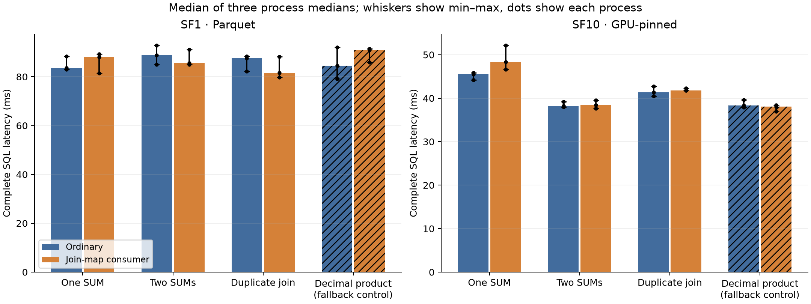
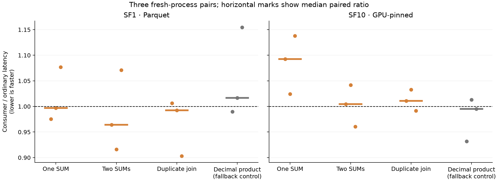

# Join-map SUM using cuDF's existing row evaluator

Reference SQL/CPU fixtures are deduplicated in `results/reference_fixtures.json.gz`; see the [artifact guide](../README.md) for validation and restoration. Generated datasets and superseded pilots were removed during cleanup.

The mechanism works, but this experiment does **not** justify a general join–aggregation optimization PR. The built Sirius engine can consume ordinary join index maps, evaluate supported expressions at matching row IDs using cuDF's existing device interpreter, and produce partial SUM states without gathering joined payload columns. Repeated complete-SQL measurements show no consistent speedup. Keep the prototype experimental and disabled by default; stop broadening its expression language or adding workload thresholds.

This is the follow-up to the [earlier fusion study](../fused_join_aggregate/REPORT.md). That report and its measurements remain intact. This study uses a newly rebuilt engine and a different implementation; results from the two campaigns must not be pooled.

## What was built

Ordinary execution:

```text
input batches → ordinary hash join → left/right match-index arrays
  → gathered joined columns → batch expression evaluator → local aggregate → merge
```

Experimental execution:

```text
input batches → same ordinary hash join → same left/right match-index arrays
  → cuDF device expression evaluator at matching row IDs
  → nullable 128-bit partial SUM per warp → existing local aggregate → merge
```

The inputs remain columnar batches. In the experimental kernel each GPU lane evaluates one matching pair by reading source columns at its two row IDs. A warp combines 32 scalar values and writes a partial state; the partial states are a small columnar table consumed by the existing aggregation pipeline. There is no joined payload table or per-match expression-result column. **The two match-index arrays still exist.** This is a consumer after map generation, not a callback fused into hash probing.

The implementation preserves the optimizer's chosen build side and ordinary hash construction, unique-key handling, batching and build/probe scheduling. It does not change the query optimizer or swap the join inputs. There is no input pre-aggregation.

The [planner rewrite](../../src/planner/sirius_plan_fused_join_aggregate.cpp) installs an optional consumer before the [ordinary gather](../../src/op/sirius_physical_hash_join.cpp). The [CUDA consumer](../../src/cuda/join_map_sum.cu) uses Sirius's existing `gpu_expression_translator`, cuDF's `expression_parser` and `expression_evaluator<true>`. It does not introduce another scalar expression interpreter. The gate is `SIRIUS_EXP_JOIN_MAP_SUM=1`; without it ordinary execution remains selected. The older private fusion/interpreter gate was off throughout this campaign.

Scope is deliberately limited: ungrouped non-distinct SUMs over an inner hash join, with supported signed integer or decimal inputs up to 64 bits and 128-bit SUM output. Each SUM expression currently references one join input; separate SUMs can reference opposite inputs. Grouping, mixed-side expressions, CASE/LIKE and unsupported casts remain ordinary. The shared Sirius translator rejects decimal arithmetic to preserve its existing width/scale semantics, so decimal multiplication remains ordinary too. Existing physical schema overrides cause the rewrite to decline. The cuDF device interfaces are private implementation APIs, and the scratch-memory bound can reject execution at runtime; this prototype is not production ready.

A separate [two-table capability check](../fused_join_aggregate/cudf_row_eval_smoke.cu) evaluated `(left.value + right.value) * left.value` using ordinary cuDF join maps: four matching pairs, two valid results, sum 68, no payload gather. It passed Compute Sanitizer. This confirms an underlying API capability; it does not establish that the current Sirius translator supports mixed-side expressions.

## Measurement and validation

The engine was rebuilt using the KvikIO-compatible build script. The measured installed `libsirius.so` SHA-256 was `cc9da8423467af70a3fe29f157c2ab6c48aa443b253eec32c9e6a15e16d856f2`, identical across all 12 timing processes and both TPC-H validation processes. The host has an NVIDIA RTX 5060 Ti with 16 GB. Processes ran serially.

Two scenarios were declared in the [driver](measure.py): SF1 Parquet through KvikIO compatibility mode, and SF10 with required columns pinned in GPU memory before timing. These differ in both scale and input placement; their difference cannot isolate either effect. Both strategies used the same binary, RMM configuration, four pipeline threads, `ast_interpret`, GPU execution enabled, CPU fallback disabled and compressed materialization disabled. A separate compression-enabled smoke check also passed the four SQL cases, with consumer execution confirmed for the three eligible cases.

Each scenario had three fresh processes per strategy, ordered ordinary/consumer, consumer/ordinary, ordinary/consumer. Each process ran two warmups and five measured executions per query: **240 measured executions and 96 warmups**, all checked against CPU results. Timings cover `execute(...).fetchall()`; extension startup, pinning and CPU reference computation are excluded. Three process pairs are a bounded study, not enough for precise confidence intervals.

The four SQL cases use genuine TPC-H lineitem rows filtered to August 1994: one price SUM, two SUMs (price and discount), a duplicate-heavy partsupp join, and a decimal-product SUM as an intentionally unsupported control. Exact SQL, references, timings, settings and compact execution logs are retained under [results](results/). Logs confirm consumer execution for every eligible timed query and none for either the control or ordinary runs. Remaining ordinary includes GPU execution; it does not mean CPU fallback.

Additional checks:

- Six full-engine SQL tests passed under Compute Sanitizer with **zero reported errors**: duplicates, null/negative values, an integer expression, all-null input, empty join and reversed SQL join order, plus the decimal-arithmetic control. See [semantic results](results/semantics/results.json) and [sanitizer output](results/memcheck.txt).
- **All 22 SF1 TPC-H queries matched CPU results with the gate off, and all 22 matched with it on.** See [validation results](results/tpch_validation.json). None activated this restricted consumer. These 44 comparisons establish regression coverage for ordinary paths; they are not evidence of TPC-H acceleration.
- The full C++ unit suite was not run for this research iteration. SQL comparisons and sanitizer checks do not prove general SQL equivalence or cover overflow boundaries.

## Plot 1: complete SQL latency



Each bar is the median of three process medians, each based on five measured queries. Dots show individual process medians and whiskers show their range. Hatched bars are the unsupported decimal-product control.

| Scenario | Query | Ordinary ms | Consumer-enabled ms | Ratio of medians |
| --- | --- | ---: | ---: | ---: |
| SF1 Parquet | One SUM | 83.57 | 88.09 | 1.054 |
| SF1 Parquet | Two SUMs | 88.80 | 85.60 | 0.964 |
| SF1 Parquet | Duplicate join | 87.62 | 81.56 | 0.931 |
| SF1 Parquet | Product control | 84.51 | 91.03 | 1.077 |
| SF10 GPU-pinned | One SUM | 45.48 | 48.34 | 1.063 |
| SF10 GPU-pinned | Two SUMs | 38.28 | 38.45 | 1.005 |
| SF10 GPU-pinned | Duplicate join | 41.34 | 41.79 | 1.011 |
| SF10 GPU-pinned | Product control | 38.31 | 38.11 | 0.995 |

**Finding:** avoiding payload gathering does not consistently reduce whole-query latency. SF10 one-SUM execution is slower, and the other eligible SF10 cases are essentially flat. SF1 shows some lower medians, but process ranges overlap and even the unchanged product control moves by 7.7% in its ratio of medians. These small improvements do not support a broad optimization claim.

**Why this can happen:** this implementation still pays for scans/filters, hash construction, match maps, source-column reads and the existing local/merge aggregation. It replaces efficient bulk gather/reduction with interpreter work per pair, creates AST/device metadata, launches a kernel for each SUM, allocates partial columns and obtains their null counts synchronously. These are concrete costs visible in the implementation. They can offset the removed columns, especially for narrow payloads. The plot cannot assign time to individual causes. The lower SF10 resident latencies are consistent with removing Parquet read/decode work, but the scenarios also differ in scale and must not be treated as a controlled I/O comparison.

## Plot 2: consistency across process pairs



Each point divides the consumer-enabled process median by its corresponding ordinary process median. The horizontal mark is the median of those three ratios. Values below one favor the consumer. This statistic differs from the ratio of medians in the preceding table; both are shown to expose sensitivity to run variation.

**Finding:** SF1's apparent duplicate-join advantage is not stable: paired ratios range from 0.903 to 1.006 and their median is 0.992. The one-SUM SF1 median paired ratio is 0.997 even though the ratio of overall medians is 1.054. In SF10, one SUM is slower in all three pairs (1.024–1.138); two SUMs and duplicate joins straddle parity. The ordinary-only control also varies, so small favorable points cannot confidently be attributed to this mechanism.

**Why this can happen:** each strategy runs in a fresh process at a different time. Cache state, GPU clock state, scheduling and other uncontrolled temporal effects can change latency. Pairing and alternating execution order reduce some bias but cannot remove it. Only three pairs were collected. These are plausible sources of variation, not separately measured explanations. No hardware-counter DRAM, occupancy or bandwidth claims are made here.

The consumer does reduce stored payload: for one SF10 part join, logs show 773,932 matching pairs and 24,188 per-warp state rows, approximately 32:1. That is a row-count calculation, not measured DRAM traffic or a peak-memory reduction claim; match maps remain allocated.

## Decision and a narrower follow-up

Stop expanding general expression fusion. Reusing the shared evaluator is feasible, but useful expression coverage and consistent end-to-end gains have not been demonstrated. Do not compensate with query names, build-side swaps or a growing threshold policy. Leave the research gate off and retain this evidence. No optimization PR has been opened or marked ready.

A cleaner candidate to investigate is **scalar `COUNT(*)` directly above an inner equijoin**. The installed cuDF `hash_join` API exposes `inner_join_size`, returning the exact match count. For this SQL shape, it could avoid both match-index arrays and payload gathering, with no scalar interpreter. Sirius's existing dense COUNT optimization targets a different grouped outer-join pattern; it does not eliminate this candidate. The ordinary hash-join implementation currently does not call `inner_join_size`.

That proposal is unimplemented and unbenchmarked. A bounded next experiment would preserve build/probe scheduling, reuse the built hash object, accumulate one count per probe batch, and return zero for an empty join. Validate duplicate multiplicity, null keys, multiple join keys and batching; exclude joins with residual predicates that the size API cannot evaluate. Compare full SQL against ordinary execution, including inputs large enough to exercise partitioning. The potential advantage follows from removing an entire output representation, rather than assuming a row interpreter will outperform vector evaluation. It is not input pre-aggregation.

## Reproduction

Use the existing generated Parquet datasets and KvikIO patch/build setup described in the [earlier report](../fused_join_aggregate/REPORT.md). All engine invocations use the repository Pixi environment; run GPU processes serially.

```bash
CMAKE_BUILD_PARALLEL_LEVEL=4 pixi run -e cuda12 bash experiments/fused_join_aggregate/build_sirius_kvikio.sh
pixi run -e cuda12 compute-sanitizer --tool memcheck --error-exitcode 99 python experiments/join_map_aggregate/check_semantics.py
pixi run -e cuda12 python experiments/join_map_aggregate/measure.py
pixi run --manifest-path experiments/fused_join_aggregate/pixi.toml python experiments/join_map_aggregate/plot.py
SIRIUS_EXP_JOIN_MAP_SUM=0 pixi run -e cuda12 python experiments/fused_join_aggregate/run_sirius.py --sf 1 --mode ordinary --repetitions 1 --warmups 0 --name map_validation_off
SIRIUS_EXP_JOIN_MAP_SUM=1 pixi run -e cuda12 python experiments/fused_join_aggregate/run_sirius.py --sf 1 --mode ordinary --repetitions 1 --warmups 0 --name map_validation_on
```

The timing driver overwrites its `finaltrial*` results when rerun. Superseded pilot folders were removed; the final CSV and plots include only the declared final trials. The plotting script regenerates both figures and [summary statistics](results/summary.json) from [raw timings](results/timings.csv).
