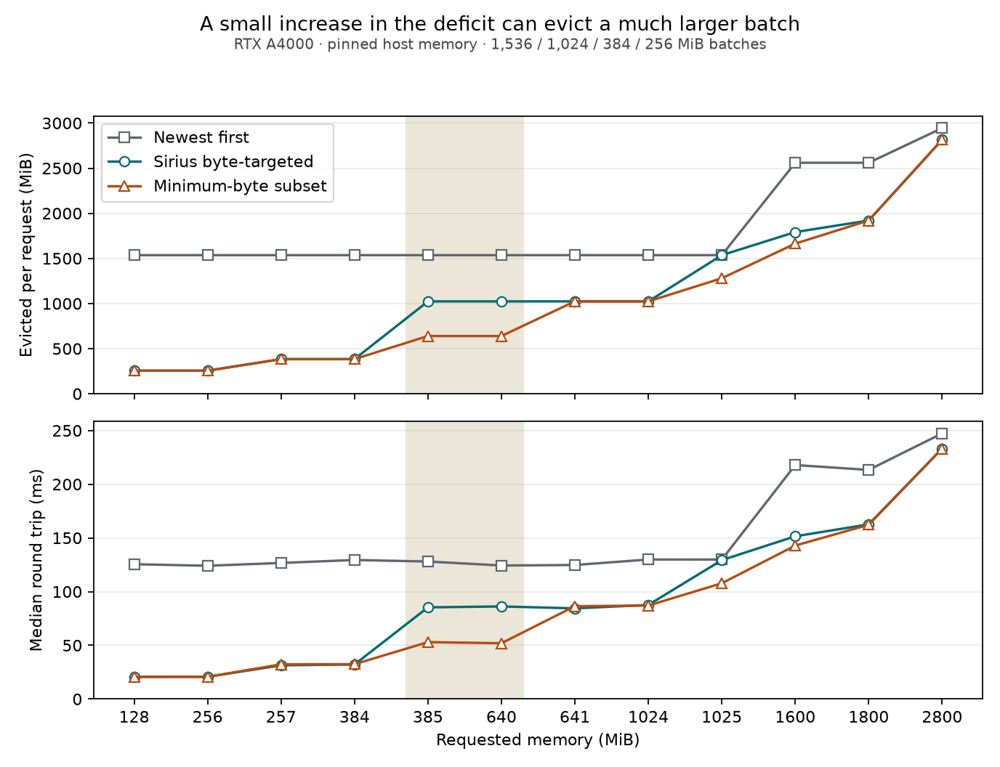

# GPU spill candidate experiment

With Sirius's GPU memory space capped at 4 GiB, increasing the reservation
shortfall from 384 MiB to 385 MiB increased eviction from 384 MiB to 1,024 MiB.
Median time to evict and restore rose from 44.6 to 117.8 ms on an RTX A4000.


| Shortfall (MiB) | Batches evicted | Evicted (MiB) | Median downgrade (ms) | Median restore (ms) |
| ---: | ---: | ---: | ---: | ---: |
| 384 | 1 | 384 | 28.8 | 15.5 |
| 385 | 1 | 1,024 | 76.8 | 40.9 |
| 640 | 1 | 1,024 | 77.1 | 40.9 |
| 1,600 | 2 | 1,792 | 134.3 | 72.5 |

The benchmark registers four cuDF batches in one repository. A 4 GiB
Sirius-managed GPU space holds these batches, and an attempted reservation
exceeds the remaining space by the stated shortfall. The benchmark checks that
the reservation is refused, runs the production byte-targeted downgrade
executor, checks that the original request now succeeds, and restores the
evicted batches using the pipeline's batch preparation helper. Each row is the
median of five timed trials after warm-up. Downgrade and restore timings use
wall-clock time. The process ran on CPUs 96–99 in the GPU's NUMA node.
[Benchmark source](../../test/cpp/downgrade/test_downgrade_executor.cpp),
[raw executor timings](executor-a4000.csv).

## Comparing candidate choices

The selector chooses the smallest individual batch that covers the deficit.
For the 385 MiB request, the 384 and 256 MiB batches together cover the shortfall
with 640 MiB. Timing those transfers independently of the executor gave 53.0 ms
for the pair and 85.3 ms for the 1,024 MiB batch, about 38% less traffic and copy
time for the pair.



| Request (MiB) | Newest first (MiB / ms) | Sirius byte-targeted (MiB / ms) | Minimum-byte subset (MiB / ms) |
| ---: | ---: | ---: | ---: |
| 256 | 1,536 / 124.1 | 256 / 20.7 | 256 / 20.7 |
| 384 | 1,536 / 129.5 | 384 / 32.1 | 384 / 32.4 |
| 385 | 1,536 / 128.0 | 1,024 / 85.3 | 640 / 53.0 |
| 640 | 1,536 / 124.3 | 1,024 / 86.2 | 640 / 51.9 |
| 1,600 | 2,560 / 217.9 | 1,792 / 151.5 | 1,664 / 142.9 |
| 2,800 | 2,944 / 247.3 | 2,816 / 233.2 | 2,816 / 233.3 |

Newest first gives a baseline where eviction follows repository order until the
fixed deficit is covered. At a 256 MiB deficit, Sirius's byte target saved
1,280 MiB of eviction and about 103 ms of round-trip copying. At 2,800 MiB, all
three plans needed most of the available data, leaving less room for the selector
to save transfers.

The [production selector](../../src/downgrade/spill_policy.hpp) keeps
newest-first order when no single batch can cover the remaining deficit, and it
preserves policy order for same-size ties. The [downgrade executor](../../src/downgrade/downgrade_executor.cpp)
uses a byte target for periodic monitor requests and explicit requests to free
a number of bytes. The [GPU pipeline executor](../../src/pipeline/gpu_pipeline_executor.cpp)
can also issue requests governed by a live reservation predicate. Its outcome
depends on concurrent allocations, releases, and conversions.

The monitor targets the distance from current usage to its stop watermark. With
a 4 GiB GPU budget and the default 80% trigger and 60% stop, crossing the trigger
by a small amount means a request of about 819 MiB. For this candidate list that
selects the 1,024 MiB batch. Changing the stop watermark to 70% would reduce the
target to about 410 MiB and still select the same batch. This is an example of how
batch granularity can hide the effect of watermark changes.

## Transfer microbenchmark

[measure.cu](measure.cu) calls the existing selector on a single repository's
synthetic newest-first list of 1,536, 1,024, 384, and 256 MiB batches. The minimum-byte
comparison exhaustively searches these four entries and breaks ties by picking
fewer batches. It estimates the transfer savings available from considering
combinations. A live policy must also account for batch reuse, extra dispatches,
and reservations that can change while an eviction is in flight.

CUDA events time actual PCIe copies to pinned host memory and back, after a
warm-up per buffer size. The CSV has five trials per policy and deficit, with
policy order rotated per trial. The plot and table use the median of each trial's
combined spill and restore time. This is a transfer microbenchmark with synthetic
deficits and preallocated GPU buffers. It measures serialized transfers and
excludes query execution, GPU allocation latency, repository contention,
compression, and disk I/O.

The measured GPU was an RTX A4000 (15,352 MiB visible VRAM, driver 595.91.07).
The process ran on CPU 96, in the GPU's NUMA node. Its [raw CSV](a4000.csv)
includes both transfer directions. End-to-end SQL spill timing was unavailable
because local Parquet and DuckDB-native scans returned `Operation canceled`
from the cuCascade I/O layer.

## Reproduce

From the repository root, use the Pixi CUDA compiler. This benchmark requires
3,200 MiB of free GPU memory and 1,536 MiB of pinned host memory. Use a CPU local
to the GPU when comparing transfer times.

```sh
pixi run --locked nvcc -std=c++17 -I src tools/spill_experiment/measure.cu -o /tmp/sirius-spill-measure
pixi run --locked /tmp/sirius-spill-measure > /tmp/sirius-spill.csv
uv run --no-project --with matplotlib python tools/spill_experiment/plot.py /tmp/sirius-spill.csv /tmp/sirius-spill.png
```

Run the executor benchmark after building the release unit-test executable.

```sh
set -o pipefail
pixi run --locked build/release/test/cpp/sirius_unittest '[spill_experiment]' |
  sed -n 's/^spill_experiment,//p' > /tmp/sirius-executor-spill.csv
uv run --no-project --with matplotlib python tools/spill_experiment/plot.py \
  /tmp/sirius-executor-spill.csv /tmp/sirius-executor-spill.png --executor
```
