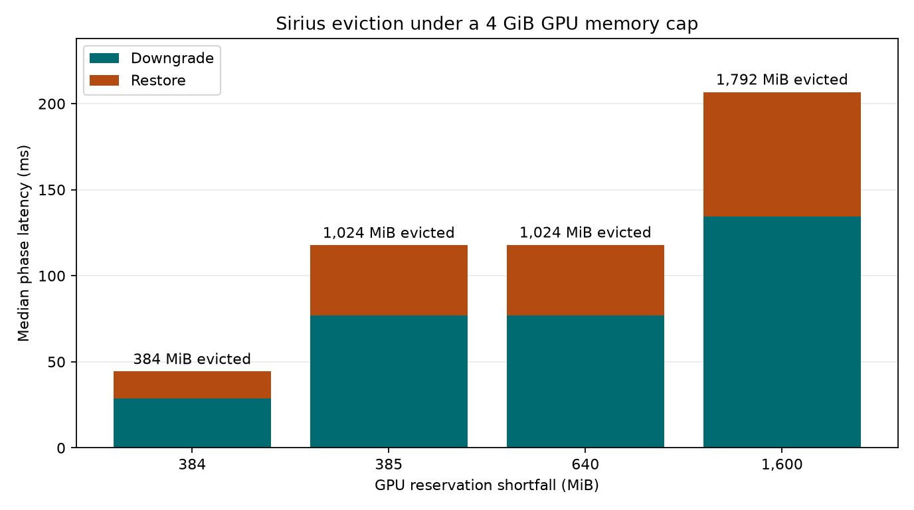
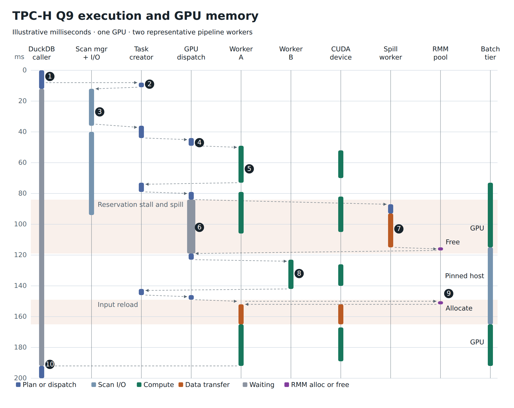

# GPU spill candidate experiment

With Sirius's GPU memory space capped at 4 GiB, increasing the reservation
shortfall from 384 MiB to 385 MiB increased eviction from 384 MiB to 1,024 MiB.
Median time to evict and restore rose from 44.6 to 117.8 ms on an RTX A4000.



| Shortfall (MiB) | Batches evicted | Evicted (MiB) | Median downgrade (ms) | Median restore (ms) |
| ---: | ---: | ---: | ---: | ---: |
| 384 | 1 | 384 | 28.8 | 15.5 |
| 385 | 1 | 1,024 | 76.8 | 40.9 |
| 640 | 1 | 1,024 | 77.1 | 40.9 |
| 1,600 | 2 | 1,792 | 134.3 | 72.5 |

The benchmark registers four cuDF batches in one repository. A 4 GiB
Sirius-managed GPU space holds these batches, and an attempted reservation
exceeds the remaining space by the stated shortfall. The benchmark checks that
the reservation is refused, runs the production byte-targeted downgrade
executor, checks that the original request now succeeds, and restores the
evicted batches using the pipeline's batch preparation helper. Each row is the
median of five timed trials after warm-up. Downgrade and restore timings use
wall-clock time. The process ran on CPUs 96–99 in the GPU's NUMA node.
[Benchmark source](../../test/cpp/downgrade/test_downgrade_executor.cpp),
[raw executor timings](executor-a4000.csv).

## Q9 execution and GPU memory timeline

Each vertical lane shares the same time axis. Segment lengths show illustrative
durations, and arrows show handoffs between components. The Batch tier lane
tracks one intermediate batch from GPU memory to pinned host memory and back.
The query caller prepares the task creator before the scan manager. The scan
manager prepares inputs asynchronously. Once a split is ready, the creator can
form a GPU scan pipeline task for a worker to execute.



During the first shaded interval, GPU dispatch waits for a reservation while
already-dispatched work can continue. The spill worker copies the batch to pinned
host memory, then releases its GPU buffers to the RMM pool. During the second
shaded interval, the consuming worker allocates destination buffers through RMM,
reloads the batch, and then resumes compute. The timeline models the execution
path using illustrative timings. The measured executor timings appear above.
[Execution flow](../../docs/super-sirius/execution-flow.md) ·
[Memory management](../../docs/super-sirius/memory-management.md)

### Numbered code references

These tags trace the direct calls and the relevant implementations behind the
arrows. The milliseconds and the assignment to workers A and B are illustrative.
The figure does not establish the actual Q9 join order, which batch Q9 spills,
or when a particular CUDA stream runs. The spill path shown uses pinned host
memory and uncompressed batches.

1. **Enter Sirius and build pipelines.** DuckDB's transparent operator calls
   `sirius_execute_query`. The interface calls `engine.initialize`, which
   delegates to `initialize_internal` to build the pipelines.
   [Transparent call](../../src/transparent/physical_sirius_execution.cpp#L386) ·
   [Interface](../../src/sirius_interface.cpp#L107) ·
   [Initialize](../../src/sirius_engine.cpp#L281) ·
   [Pipeline construction](../../src/sirius_engine.cpp#L384)
2. **Prepare the creator, then the scan manager.** `engine.execute` calls
   `create_query`. Inside it, the query caller calls both preparation functions
   in order. The connector between the lanes represents that ordering.
   [Engine call](../../src/sirius_engine.cpp#L324) ·
   [Ordered calls](../../src/sirius_context.cpp#L1435) ·
   [Creator setup](../../src/creator/task_creator.cpp#L135) ·
   [Scan setup](../../src/scan_manager/sirius_scan_manager.cpp#L1486) ·
   [Start scan coordinator](../../src/scan_manager/sirius_scan_manager.cpp#L2129)
3. **Start scheduling and supply scan input.** The engine calls
   `start_query`, which schedules the first scan operator. Independently, the
   scan preparation coordinator publishes an input to its split connector.
   The scan operator exposes readiness and provides the input to the creator.
   [Engine call](../../src/sirius_engine.cpp#L333) ·
   [Schedule first scan](../../src/pipeline/task_scheduler.cpp#L235) ·
   [Publish prepared input](../../src/scan_manager/preparation_coordinator.cpp#L1055) ·
   [Connector](../../src/scan_manager/split_connector.cpp#L61) ·
   [Scan readiness and input](../../src/op/scan/sirius_gpu_scan_operator.cpp#L679)
4. **Create, reserve, and dispatch a GPU task.** The creator resolves a readiness
   hint, pulls input, constructs a `gpu_pipeline_task`, and schedules it.
   The GPU executor attempts a reservation and dispatches a callable that
   invokes `task->execute(stream)`. The same dispatch path is used for later
   build and probe tasks.
   [Readiness](../../src/creator/task_creator.cpp#L629) ·
   [Pull input](../../src/creator/task_creator.cpp#L705) ·
   [Construct and schedule](../../src/creator/task_creator.cpp#L858) ·
   [Scheduler](../../src/pipeline/task_scheduler.cpp#L132) ·
   [Reserve](../../src/pipeline/gpu_pipeline_executor.cpp#L229) ·
   [Dispatch and execute](../../src/pipeline/gpu_pipeline_executor.cpp#L411) ·
   [Worker dispatch helper](../../src/exec/leased_callable.hpp#L58) ·
   [Task implementation](../../src/pipeline/gpu_pipeline_task.cpp#L678)
5. **Materialize a scan and publish output.** The scan operator invokes the
   selected ingestible's `materialize_table` on the task stream. Task output
   reaches the sink through `publish_output`. Pipeline status processing
   schedules eligible consumers.
   [Scan operator](../../src/op/scan/sirius_gpu_scan_operator.cpp#L811) ·
   [Materialization call](../../src/op/scan/sirius_gpu_scan_operator.cpp#L413) ·
   [Ingestible dispatch](../../src/op/scan/gpu_ingestible.cpp#L83) ·
   [Parquet implementation](../../src/op/scan/parquet_scan_core.cpp#L2444) ·
   [Publish call](../../src/pipeline/gpu_pipeline_task.cpp#L845) ·
   [Sink call](../../src/pipeline/gpu_pipeline_task.cpp#L646) ·
   [Schedule consumers](../../src/pipeline/sirius_pipeline.cpp#L307)
6. **Reservation shortfall triggers downgrade.** The dispatcher calls
   `request_downgrade` and waits on its future. The predicate retries
   `make_reservation_or_null`. The downgrade executor queues the request and
   runs eligible batch conversions. Already-dispatched work runs in the
   worker callable from tag 4.
   [Request, wait, and predicate](../../src/pipeline/gpu_pipeline_executor.cpp#L302) ·
   [Reservation implementation](../../cucascade/src/memory/memory_space.cpp#L233) ·
   [Enqueue](../../src/downgrade/downgrade_executor.cpp#L948) ·
   [Invoke conversion](../../src/downgrade/downgrade_executor.cpp#L475)
7. **Copy GPU to host, then release device buffers.** The batch wrapper calls
   `convert_to<host_data_representation>`. The registered chunked converter
   submits CUDA copies and synchronizes before returning. The batch installs
   the new representation, releasing the old one. Device deallocation goes
   through the reservation-aware adaptor to the upstream allocator.
   [Host conversion call](../../src/data/convertible_data_batch.hpp#L157) ·
   [Registry setup](../../src/data/sirius_converter_registry.hpp#L66) ·
   [Submit copies](../../src/data/spill_chunked_converters.cpp#L209) ·
   [Synchronize](../../src/data/spill_chunked_converters.cpp#L300) ·
   [Install converted representation](../../cucascade/include/cucascade/data/data_batch.hpp#L682) ·
   [Upstream deallocation](../../cucascade/src/memory/reservation_aware_resource_adaptor.cpp#L537)
8. **Resume dispatch and make probe work eligible.** The successful reservation
   lets dispatch proceed through tag 4. Hash join execution manages build and
   probe state. Publication and downstream scheduling use the sink and
   pipeline mechanisms in tag 5.
   [Resume after downgrade](../../src/pipeline/gpu_pipeline_executor.cpp#L329) ·
   [Hash join execution](../../src/op/sirius_physical_hash_join.cpp#L1691) ·
   [Downstream scheduling](../../src/pipeline/sirius_pipeline.cpp#L307)
9. **Allocate device buffers and reload.** The task attaches its reservation to
   the allocation tracker before preparing inputs. The operator-data path
   calls `lock_and_prepare_batch`, which converts a host-resident batch to
   GPU. The host-to-GPU converter allocates through the target resource,
   submits the copies, and synchronizes before returning the GPU representation.
   [Attach reservation](../../src/pipeline/gpu_pipeline_task.cpp#L710) ·
   [Prepare inputs](../../src/pipeline/gpu_pipeline_task.cpp#L745) ·
   [Input helper call](../../src/op/sirius_physical_operator.cpp#L157) ·
   [Convert call](../../src/pipeline/batch_lock_utils.hpp#L179) ·
   [Registry entry](../../cucascade/src/cudf/representation_converter_builtins.cpp#L1912) ·
   [Allocate, copy, and synchronize](../../cucascade/src/cudf/representation_converter_builtins.cpp#L1185) ·
   [Allocator](../../cucascade/src/memory/reservation_aware_resource_adaptor.cpp#L426)
10. **Complete the query and return rows.** A terminal task publishes into the
    result collector. The terminal execution path calls `mark_completed`,
    allowing the engine's wait to finish. The interface then fetches the
    collector result. The final block condenses several operator tasks into
    one span.
    [Collector sink](../../src/op/sirius_physical_result_collector.cpp#L125) ·
    [Signal completion](../../src/pipeline/gpu_pipeline_executor.cpp#L586) ·
    [Completion handler](../../src/pipeline/completion_handler.hpp#L180) ·
    [Engine waits](../../src/sirius_engine.cpp#L340) ·
    [Wait implementation](../../src/scan_manager/sirius_scan_manager.cpp#L2132) ·
    [Extract result](../../src/sirius_engine.cpp#L270)

## Comparing candidate choices

The selector chooses the smallest individual batch that covers the deficit.
For the 385 MiB request, the 384 and 256 MiB batches together cover the shortfall
with 640 MiB. Timing those transfers independently of the executor gave 53.0 ms
for the pair and 85.3 ms for the 1,024 MiB batch, about 38% less traffic and copy
time for the pair.


| Request (MiB) | Newest first (MiB / ms) | Sirius byte-targeted (MiB / ms) | Minimum-byte subset (MiB / ms) |
| ---: | ---: | ---: | ---: |
| 256 | 1,536 / 124.1 | 256 / 20.7 | 256 / 20.7 |
| 384 | 1,536 / 129.5 | 384 / 32.1 | 384 / 32.4 |
| 385 | 1,536 / 128.0 | 1,024 / 85.3 | 640 / 53.0 |
| 640 | 1,536 / 124.3 | 1,024 / 86.2 | 640 / 51.9 |
| 1,600 | 2,560 / 217.9 | 1,792 / 151.5 | 1,664 / 142.9 |
| 2,800 | 2,944 / 247.3 | 2,816 / 233.2 | 2,816 / 233.3 |

Newest first gives a baseline where eviction follows repository order until the
fixed deficit is covered. At a 256 MiB deficit, Sirius's byte target saved
1,280 MiB of eviction and about 103 ms of round-trip copying. At 2,800 MiB, all
three plans needed most of the available data, leaving less room for the selector
to save transfers.

The [production selector](../../src/downgrade/spill_policy.hpp) keeps
newest-first order when no single batch can cover the remaining deficit, and it
preserves policy order for same-size ties. The [downgrade executor](../../src/downgrade/downgrade_executor.cpp)
uses a byte target for periodic monitor requests and explicit requests to free
a number of bytes. The [GPU pipeline executor](../../src/pipeline/gpu_pipeline_executor.cpp)
can also issue requests governed by a live reservation predicate. Its outcome
depends on concurrent allocations, releases, and conversions.

The monitor targets the distance from current usage to its stop watermark. With
a 4 GiB GPU budget and the default 80% trigger and 60% stop, crossing the trigger
by a small amount means a request of about 819 MiB. For this candidate list that
selects the 1,024 MiB batch. Changing the stop watermark to 70% would reduce the
target to about 410 MiB and still select the same batch. This is an example of how
batch granularity can hide the effect of watermark changes.

## Transfer microbenchmark

[measure.cu](measure.cu) calls the existing selector on a single repository's
synthetic newest-first list of 1,536, 1,024, 384, and 256 MiB batches. The minimum-byte
comparison exhaustively searches these four entries and breaks ties by picking
fewer batches. It estimates the transfer savings available from considering
combinations. A live policy must also account for batch reuse, extra dispatches,
and reservations that can change while an eviction is in flight.

CUDA events time actual PCIe copies to pinned host memory and back, after a
warm-up per buffer size. The CSV has five trials per policy and deficit, with
policy order rotated per trial. The plot and table use the median of each trial's
combined spill and restore time. This is a transfer microbenchmark with synthetic
deficits and preallocated GPU buffers. It measures serialized transfers and
excludes query execution, GPU allocation latency, repository contention,
compression, and disk I/O.

The measured GPU was an RTX A4000 (15,352 MiB visible VRAM, driver 595.91.07).
The process ran on CPU 96, in the GPU's NUMA node. Its [raw CSV](a4000.csv)
includes both transfer directions. End-to-end SQL spill timing was unavailable
because local Parquet and DuckDB-native scans returned `Operation canceled`
from the cuCascade I/O layer.

## Reproduce

From the repository root, use the Pixi CUDA compiler. This benchmark requires
3,200 MiB of free GPU memory and 1,536 MiB of pinned host memory. Use a CPU local
to the GPU when comparing transfer times.

```sh
pixi run --locked nvcc -std=c++17 -I src tools/spill_experiment/measure.cu -o /tmp/sirius-spill-measure
pixi run --locked /tmp/sirius-spill-measure > /tmp/sirius-spill.csv
uv run --no-project --with matplotlib python tools/spill_experiment/plot.py /tmp/sirius-spill.csv /tmp/sirius-spill.png
```

Run the executor benchmark after building the release unit-test executable.

```sh
set -o pipefail
pixi run --locked build/release/test/cpp/sirius_unittest '[spill_experiment]' |
  sed -n 's/^spill_experiment,//p' > /tmp/sirius-executor-spill.csv
uv run --no-project --with matplotlib python tools/spill_experiment/plot.py \
  /tmp/sirius-executor-spill.csv /tmp/sirius-executor-spill.png --executor
```
