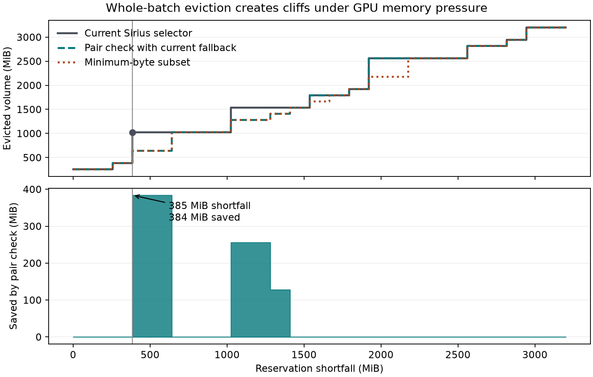

# GPU spill policy research for Sirius

**First experiment.** Let the byte-targeted downgrade executor compare a small
set of eligible batch pairs with its current eviction choice. Keep the existing
policy when the pair offers little benefit or would evict data needed soon.
This tests whether Sirius can reduce reservation stalls caused by whole-batch
eviction without changing its operators, memory tiers, or SQL interface.

## What prior work suggests

| Prior work | Result and implication for Sirius |
| --- | --- |
| Sirius, CIDR 2026 | The prototype presented spilling and pipelined batches as future work. The current checkout already has tiered downgrade, restore, and optional spill compression. The open question is which bytes to evict, when to move them, and how much of the movement falls on the query's critical path. [Paper](https://www.vldb.org/cidrdb/2026/rethinking-analytical-processing-in-the-gpu-era.html) |
| Triton Join, SIGMOD 2022 | It partitions large joins out of core and keeps some partitions on device. The authors also report a substantial penalty for gathering wide payloads via random host accesses. In Sirius, test planned partition placement and grouped restores on wide joins. Measure interconnect traffic and access pattern as well as partition size. [Paper, sections 5 and 6](https://www.dfki.de/fileadmin/user_upload/import/12723_Triton.pdf) |
| HetExchange, PVLDB 2019 | Its memory movement operator uses the plan to prefetch data for consumers and overlaps DMA with execution. Sirius could use ready-task information to protect imminent inputs and prefetch a bounded amount for the next consumer. The test is whether it removes stalls after accounting for speculative transfers. [Paper, section 3](https://www.vldb.org/pvldb/vol12/p544-chrysogelos.pdf) |
| RUMMY, NSDI 2024 | It groups and reorders vector-query work to reuse transferred clusters and overlap I/O with kernels. For relational queries, try scheduling already-ready consumers of a restored partition together, within existing dependencies and fairness limits. Match the amount of requested work when comparing scheduling policies. [Paper](https://www.usenix.org/system/files/nsdi24-zhang-zili-pipelining.pdf) |
| Dynamic Tensor Rematerialization, ICLR 2021 | It uses execution metadata to choose what to discard and recompute under a memory budget. In Sirius, compare copying with recomputing cheap deterministic projections or rereading a snapshot-bound input. Begin with inputs whose ownership and lifetime are explicit. [Paper](https://ztatlock.net/pubs/2021-iclr-dtr/2021-iclr-dtr.pdf) |

## What the Sirius measurements show

On an RTX A4000 with a 4 GiB Sirius GPU memory cap, raising the reservation
shortfall from 384 to 385 MiB increased actual eviction from 384 to 1,024 MiB.
Median eviction plus restore increased from 44.6 to 117.8 ms in the capped-pool
executor test. In a separate CUDA copy benchmark, moving the 384 and 256 MiB
batches took 53.0 ms versus 85.3 ms for the 1,024 MiB batch. The latter comparison
isolates serialized PCIe transfer, with the same bytes copied back to the GPU
after each eviction. It does not measure the executor running a pair policy.
[Experiment and raw data](README.md)

The plot enumerates every integer shortfall from 1 to 3,200 MiB with one idle
repository and the measured candidate order of 1,536, 1,024, 384, and 256 MiB.
The current policy takes the smallest remaining single batch that covers the
deficit. If none covers it, it takes the first remaining batch in repository
order and repeats. The modeled pair policy compares the **total** bytes of
that plan with the smallest covering single or pair. The minimum-byte
reference enumerates every nonempty subset.

The upper panel shows how much each policy would evict. The lower panel
isolates where checking pairs helps. It reduces eviction at **640 of 3,200**
shortfalls, with a maximum saving of **384 MiB**. At 385 MiB it chooses
384 + 256 MiB, reducing eviction from 1,024 to 640 MiB. At 641 MiB that pair
no longer covers the request. At 1,600 MiB an exhaustive policy can combine
1,024 + 384 + 256 MiB for 1,664 MiB, while both the current and pair policies
choose 1,792 MiB. Under a uniform weighting of the modeled shortfalls, the pair
check removes **61% of the byte gap** between current selection and the exact
minimum. This is a property of the four sizes and the chosen weighting.
Production savings depend on the observed shortfall distribution, legal
candidates, and how often evicted data returns.

## Research plan for Sirius

1. **Measure before changing selection.** Collect a bounded decision trace for
   byte-targeted requests, including deficit, eligible sizes in order, planned
   and actual relief, target tier, copy waits, and time to next use. Correlate
   spill and restore with a stable batch identity. Keep monitor requests,
   explicit byte requests, and live reservation predicates visible separately.
   The current GPU pipeline can issue a predicate-only request, so results
   from fixed targets cannot be extrapolated to every GPU reservation stall.
   [Selector](../../src/downgrade/spill_policy.hpp),
   [executor](../../src/downgrade/downgrade_executor.cpp),
   [reservation path](../../src/pipeline/gpu_pipeline_executor.cpp)
2. **Replay and test bounded lookahead.** Replay recorded candidate sets and
   compare current selection with a window of eligible pairs, initially
   8–16 candidates per repository. Treat results as decision estimates since
   alternative evictions would change later candidate sets. In a live A/B,
   recheck eligibility, target-tier space, and remaining deficit before
   dispatching each batch. Require estimated savings of at least one dispatch
   and expected restore cost before choosing two batches. Keep planned-byte
   accounting, cancellation, and early stop behavior in the experiment.
   Track CPU time spent selecting candidates and first-relief latency.
3. **Add consumer awareness only if restore churn is material.** Check how often
   a spilled batch is restored before the request that caused the eviction has
   finished, or is evicted repeatedly within one query. Use scheduler readiness
   and repository ownership as signals to protect imminent consumers. Test
   whether draining ready work or coalescing related reads reduces stall time
   before adding speculative prefetch. Charge prefetch against the same GPU
   budget and withdraw it when reservations queue.
4. **Move partition sizing upstream if the remaining misses are large.** Sweep
   partition targets around the observed cliff on wide, skewed joins and
   high-cardinality aggregation. Size for the live build/probe and scratch
   footprint and compare keeping hot partitions resident with staging cold
   partitions once to host. Test spill compression separately because it
   consumes GPU scratch and changes transfer bytes. Consider recomputation
   later for deterministic, snapshot-stable inputs with cheap lineage.
   [Sirius memory management](../../docs/super-sirius/memory-management.md)

## How to evaluate it

Start with the existing forced-reservation benchmark and a dense sweep around
the 384/385 MiB transition. Then use TPC-H Q9 and synthetic skewed joins and
group-bys with narrow and wide rows. Sweep the cap on both sides of the measured
no-spill working set. Run one and four concurrent queries, record queueing time
as well as execution time, and compare host-only spilling with NVMe enabled in
a separate experiment. On each device, warm up then interleave the baseline
and candidate policy, retaining per-run results and reporting median and p95.

Primary outcomes are p95 query latency and time blocked on GPU reservations.
Report throughput, spill and restore bytes by tier, repeated evictions,
policy CPU time, retries, and correctness against DuckDB CPU results. As an
initial acceptance target, seek at least 10% lower p95 on spill-heavy cases,
with at most 2% slowdown on no-spill controls and no new failures. Compare
PCIe and a faster interconnect when hardware is available, since dispatch,
copy, and restoration costs can change their relative importance.

The reported GPU results come from the existing Sirius executor and CUDA copy
benchmarks. Local SQL scan attempts on that host failed in cuCascade I/O, so
query-level effects remain unmeasured. The plot is an offline selection model,
with no I/O overlap, concurrency, target-tier capacity limits, or reuse.

Regenerate the figure from the repository root with
`uv run --no-project --with matplotlib python tools/spill_experiment/plot_research.py`.
